## The first post with a picture in it

Six posts in, everything has been text.

[Post 1](/posts/llm-architectures-attention-and-rope/) took a transformer block apart and put a cost on every piece. [Post 2](/posts/llm-architectures-kv-cache/) cached keys and values so a model stops redoing work for every new token. [Post 3](/posts/llm-architectures-flash-attention/) computed attention in tiles to move fewer bytes. [Post 4](/posts/llm-architectures-quantization/) stored each weight in fewer bits. [Post 5](/posts/llm-architectures-mixture-of-experts/) built a model that runs only some of its parameters for each token. [Post 6](/posts/llm-architectures-lora/) fine-tuned a model by training a small adapter beside its frozen weights, **0.89%** of its parameters.

Every one of those models took text in and gave text out. This post gives one a picture.

A model that takes more than one kind of input, here pictures and text, is called **multimodal**, and one that reads pictures and writes text is a **vision-language model**, or VLM. The surprising thing about how most of them work is how little of the language model has to change. The picture gets turned into a short run of vectors, the same width as the vectors the language model already uses for words, and the language model reads those vectors as if they were words. Getting there takes three parts and two rounds of training, and this post builds all of it on a laptop:

<!-- FIGURE: vlm-overview -->
{: .light width="1000" height="488" }
{: .dark width="1000" height="488" }

The question this post tests is whether that's enough. With both big models frozen, can training only the small part between them get a language model to answer questions about a picture? And when it answers right, is it reading the picture, or guessing from the question?

### The short version {#the-short-version}

Can we turn a small language model into a vision-language model without retraining the whole thing?

That's what I wanted to find out.

I started with two pretrained models: **SigLIP-base** to understand images and **Qwen2.5-0.5B** to generate text (the same language model from posts 4 and 6). I froze both, meaning their weights never changed, and trained only a small **connector** between them.

The training data was deliberately simple: generated pictures containing colored shapes. I wanted to see whether the model could learn to describe what it saw, answer questions about individual shapes, and handle color-shape combinations it had never encountered during training.

The connector has just **3.6 million trainable parameters**, about 0.7% of the language model's 494 million.

#### How does it work?

The idea is surprisingly simple: **turn a picture into something a language model can process alongside text.**

There are three steps:

1. **The vision encoder reads the picture.** It divides the image into 16 × 16-pixel patches, converts each patch into a vector, and processes all the patches together using a vision transformer. Unlike a language model generating text, the vision encoder lets every patch attend to every other patch ([§1](#pixels-to-patches)).

2. **The connector translates between vision and language.** SigLIP produces 196 patch vectors, each 768 numbers wide. The connector combines neighbouring patches in groups of four, reducing 196 vectors to 49, then projects them to the language model's hidden size, the 896 numbers in each of its word vectors ([§2](#the-connector)).

3. **The language model processes the picture and text together.** The 49 image tokens become part of the input sequence, alongside the text tokens. The language model processes them using its existing transformer architecture. The architecture doesn't need to change, although training is still needed to make those image representations useful ([§7](#text-pictures-or-both)).

That's the basic recipe behind the architecture we're exploring: a vision encoder, a connector, and a language model.

#### What did the experiments show?

I trained the connector in two stages:

- **Stage 1 — Learn to describe pictures.** Given an image, generate a caption describing the shapes and their colors.
- **Stage 2 — Learn to answer questions.** Given an image and a question such as "What color is the triangle?", produce the correct answer.

I also trained comparison models without the captioning stage, with extra captions mixed into question-answer training, and with LoRA enabled on the language model.

Here are the results that stood out:

| Experiment | Result |
|---|---|
| Captioning new pictures after stage 1 | **91/120** exactly correct |
| Color questions on familiar color-shape combinations | **98/100** correct |
| Same questions on combinations excluded from training | **76/100** correct |
| Unseen combinations, without stage 1 | **40/100** correct |
| With vs. without stage 1, repeated across five seeds | **Stage 1 won all five** |

The most interesting result wasn't how well the model performed on familiar examples. All three trained versions did well there.

It was what happened when I asked about **combinations the model had never seen during training**.

For example, suppose training included red circles and blue triangles, but never a red triangle. Could the model still answer "What color is the triangle?" when shown a red triangle?

This is a harder test because the model can't simply rely on the colors usually associated with each shape. It has to identify the shape and its color in the actual picture.

The two-stage model scored 76/100 on these unseen combinations, compared with 40/100 for the model trained without the captioning stage.

To check whether this was just a lucky training run, I repeated the comparison across five paired random seeds, using 300 fresh questions per evaluation. **Captioning first helped in all five runs**, with a median advantage of 25 percentage points ([§6](#five-seeds)).

That doesn't prove the model has learned general visual reasoning. But it does suggest that learning to describe complete pictures before answering targeted questions helps it handle new combinations of familiar visual features.

#### A few other things I learned

**1. A correct answer doesn't necessarily mean the model looked at the picture.**

When I replaced the real image with a blank one, the models could still answer some questions correctly. On counting questions, for example, they scored around 32/100 without useful visual information.

That's why I also tested blank, incorrect, and missing images. Depending on the question and model, the real picture improved accuracy by 59–70 percentage points over the strongest control. Without those controls, it would be easy to mistake good guessing for actual visual understanding ([§5](#is-it-looking)).

**2. The training recipe mattered more than making the language model trainable.**

Adding LoRA to the language model didn't produce a measurable improvement beyond the variation across three seeds. Mixing additional captions into stage 2 helped with questions about the leftmost shape, but didn't improve the unseen color-shape binding test.

For this small task, what the connector learned, and the order in which it learned it, mattered more than adding trainable parameters to the language model ([§4](#stage-two), [§6](#five-seeds)).

**3. Pictures have a real compute and memory cost.**

In this implementation, one image takes 49 positions in the language model's input sequence, compared with just a few tokens for a short text description.

Without patch merging, the image would take 196 positions. Reducing that to 49 made training steps about 3× faster, and in this experiment it didn't cost accuracy: the merged version captioned 91 of 120 pictures right, against 76. It also cut the bf16 KV cache each image needs, calculated from the model's shape, from 2.30 MiB to 0.57 MiB ([§8](#what-an-image-costs)).

This is one reason image token counts matter when deploying multimodal models at scale.

#### The bigger picture

This experiment explores just one way to connect vision and language: **convert an image into vectors and insert them directly into the language model's input sequence.**

Other architectures use a fixed number of learned visual tokens, cross-attention between language and vision, or discrete image tokens. We'll compare those designs later in the post ([§9](#other-designs)).

And an important limitation: these experiments use simple, generated pictures of colored shapes, not real photographs. The results help us understand how the architecture and training process behave under controlled conditions. They don't establish how well this model would perform on real-world vision tasks.

### Setup

Everything below is measured, and you can re-run all of it:

```bash
git clone https://github.com/bearbearyu1223/llm-architectures-refresher
cd llm-architectures-refresher
uv sync && uv run demo07
```

The code is in [`demos/d07_multimodal.py`](https://github.com/bearbearyu1223/llm-architectures-refresher/blob/main/src/llmrefresher/demos/d07_multimodal.py), and the model itself is in [`vlm.py`](https://github.com/bearbearyu1223/llm-architectures-refresher/blob/main/src/llmrefresher/vlm.py): the patch cutting, the connector, and the code that splices a picture into a sentence are all written out rather than imported, because this series builds the thing it's explaining. Every number this post quotes is printed by that program, and each block of its output, which I call a **receipt**, names the function that printed it.

A warning about time: the demo *trains*, eleven times, and takes over **two and a half hours** on my Mac. Most of that is stage 2's three versions, each trained three times from different seeds, and one stage 1 run on 196 tokens per picture, which is three times slower than the rest. `uv run demo07 --figures` redraws the figures from the last run's saved scores in seconds (`--followup-figures` draws §6's five-seed figure). The five-seed check in §6 is a separate program, `uv run demo07 --followup`, which trains 20 more times and takes about three and a half hours more.

Each training run starts from a fixed **seed**, the number that sets its random starting weights and the order it sees examples in, so it's repeatable on the same machine: in an earlier version, I stopped and restarted the demo partway through, and stage 1 and the first stage-2 run printed identical scores both times. Expect a different machine to move some scores by a point or two, since floating-point sums can be ordered differently.

**The three parts.**

- The **vision encoder** is [SigLIP-base](https://huggingface.co/google/siglip-base-patch16-224) ([paper](https://arxiv.org/abs/2303.15343)), a 12-layer transformer that was trained on pictures and their captions. It stays frozen the whole time.
- The **language model** is **Qwen2.5-0.5B**, the same model [post 4](/posts/llm-architectures-quantization/) quantized and [post 6](/posts/llm-architectures-lora/) fine-tuned ([the weights](https://huggingface.co/Qwen/Qwen2.5-0.5B), [the report](https://arxiv.org/abs/2412.15115)). It's a plain text model; nothing about it was built for pictures. It stays frozen too, except for the LoRA adapters one of the stage-2 runs adds.
- The **connector** is the only new part. It starts random and is trained from scratch.

Both models download on the first run. Everything runs in fp32, four bytes per number, as in post 6, so that two training runs can only differ in what they train.

#### The pictures, and what the model is asked {#the-pictures}

The demo draws its own pictures: up to four colored shapes on a white square, each a circle, a square or a triangle in one of six colors. Here's what it's taught to say about them, using the picture from the figure above:

- **Stage 1, describe.** Given the picture and `Caption:`, write every shape from left to right: `an orange circle, a yellow circle and a purple circle`.
- **Stage 2, count.** `How many shapes are there?` is answered `three`.
- **Stage 2, binding** (tying a color to its shape). `What color is the triangle?` is answered with that triangle's color. It's only asked when the picture has exactly one triangle, so there's always one right answer. (The picture in the figures has three circles, so it never gets this question.)
- **Stage 2, leftmost.** `What color is the leftmost shape?` is answered `orange`.

**Binding** is the name for tying two facts about one object together: it's not enough to see that there's a triangle and that there's purple somewhere, the model has to know the purple belongs to the triangle.

Generated pictures are a deliberate choice, and the biggest limitation of this post. Every answer is exact, so a score of 76 of 100 means 76 answers were exactly right and nothing else. The test pictures are new ones drawn from a different random seed, so a score is a score on pictures the model has never seen. No dataset has to be downloaded or cleaned. The price is that these pictures are far easier than photographs, so the numbers here say how the mechanism behaves, not how good a VLM this is.

**Three pairs are kept out of training.** Six colors and three shapes make 18 color-shape pairs. A red triangle, a green circle and a blue square never appear in any training picture, though red, green, blue, triangles, circles and squares all do. A second test set asks only about those three pairs. A new picture isn't much of a test if it's made of pairs the model trained on about a thousand times each, while a pair it has never seen is: to say "red" for a triangle, it has to read the color off the shape rather than remember which colors triangles come in. [§6](#pairs-never-seen) has that test.

Here's the whole experiment on one page, the data, the training runs and the tests, before the sections go through each piece:

<!-- FIGURE: experiment -->
{: .light width="1000" height="454" }
{: .dark width="1000" height="454" }

### Table of Contents

Skip to [the short version](#the-short-version) for the findings without the derivations.

1. [From pixels to patches](#pixels-to-patches), and [inside the encoder](#inside-the-encoder)
2. [The connector](#the-connector)
3. [Stage 1: learning to describe](#stage-one)
4. [Stage 2: learning to answer](#stage-two)
5. [Is it actually looking?](#is-it-looking)
6. [Pairs it never saw](#pairs-never-seen), and [five seeds, three checks](#five-seeds)
7. [Text, a picture, or both](#text-pictures-or-both)
8. [What an image costs](#what-an-image-costs)
9. [Other ways to connect a picture](#other-designs)
10. [What follows from all this](#what-follows)
11. [Sidebar: the probe](#sidebar-the-probe)

Plus [all notation](#appendix-all-notation) at the end.

---

### 1. From pixels to patches {#pixels-to-patches}

A transformer doesn't work on raw text, and it doesn't work on raw pixels either. It works on a sequence of vectors. A language model gets its vectors by looking each token up in a table ([post 1](/posts/llm-architectures-attention-and-rope/) walked through it). So for a picture, the question is the same one: how do you turn it into a sequence of vectors?

The obvious answer, one vector per pixel, doesn't scale. A 224 × 224 picture has 50,176 pixels. As a sequence, that's 256 times as long as the 196 vectors this section ends with, and since attention compares every position with every other, it's 256² = 65,536 times as many comparisons ([post 3](/posts/llm-architectures-flash-attention/) showed how fast that grows).

The answer most models use comes from the **vision transformer** (ViT) paper by [Dosovitskiy et al.](https://arxiv.org/abs/2010.11929), playfully titled *An Image is Worth 16x16 Words*. The "16x16" is the size of one patch in pixels, not 256 actual words. The idea is to cut the picture into a grid of small squares, called **patches**, and treat each patch the way a language model treats a token: turn it into a vector, then let a transformer process the sequence.

<!-- FIGURE: image-to-patches -->
{: .light width="1000" height="384" }
{: .dark width="1000" height="384" }

Take it one step at a time.

1. **A picture is a grid of numbers.** Each pixel is three numbers, how much red, green and blue it has. SigLIP takes pictures 224 pixels on a side.
2. **Cut it into patches.** The patches are squares 16 pixels on a side that don't overlap. 224 ÷ 16 = 14, so the picture becomes a 14 × 14 grid of 196 patches. Each patch will become one position in the sequence, the way a token does.
3. **Flatten each patch.** Write a patch's pixels out in one long row: 16 × 16 pixels × 3 colors = 768 numbers. Nothing has been learned yet. These are the same pixels, in a different order.
4. **Multiply by one learned matrix.** A 768 × 768 matrix turns the 768 pixel values into a 768-wide vector, the **patch embedding**. The ViT paper describes this step as mapping the flattened patches "to D dimensions with a trainable linear projection" (§3.1). The size happens to stay the same here; what changes is what the numbers mean. Going in, each is one pixel's brightness in one color. Coming out, each is a learned mix of all 768, and SigLIP's training chose the mixes that turned out useful. The same matrix is used for every patch.
5. **Add a position.** Shuffle the 196 patch vectors and nothing in them says where each came from, the top-left corner or the middle of the circle. So each of the 196 grid positions has its own learned vector, also 768 wide, and it's added to the patch vector number by number. The result is still 768 numbers, not 1,536.

**This is like a word's embedding, but it isn't a lookup.** Both steps give the transformer one learned vector per position. The difference is where the vector comes from:

| | language model | vision encoder |
|---|---|---|
| input | a token id | a patch's 768 pixel values |
| how | pick that token's row of a table | multiply the pixel values by one matrix |
| what's learned | a separate vector for every token in the vocabulary | one matrix, shared by all 196 patches |

The two are closer than the table makes them look: picking row 5 of a table is the same as multiplying it by a row of zeros with a single 1 in place 5. A token id is that one-hot row; a patch brings 768 real values instead.

Here are the shapes for one picture, from pixels to the encoder's output:

| step | shape |
|---|---|
| the picture | 3 × 224 × 224 (colors, height, width) |
| cut into patches and flattened | 196 × 768 |
| times the matrix | 196 × 768 |
| plus the positions | 196 × 768 |
| after the encoder's 12 layers | 196 × 768 |

The original ViT also put one extra learned vector at the front of the sequence, to collect a summary for classifying the picture. SigLIP doesn't: its position table has exactly 196 rows, one per patch, and its output is 196 vectors.

**So far, no patch has looked at any other.** Each patch embedding was made from its own 256 pixels and its own position, nothing else. That's only the encoder's *input*. Its 12 transformer layers come next ([inside the encoder](#inside-the-encoder), below), and they're where patches exchange information: every patch attends to every other patch, so by the end each vector carries information about the whole picture, not just its own 16 × 16 square. Those outputs, not the patch embeddings, are what the connector in [§2](#the-connector) receives.

Here are the numbers, from the real encoder ([`pixels_to_patches`](https://github.com/bearbearyu1223/llm-architectures-refresher/blob/main/src/llmrefresher/demos/d07_multimodal.py)):

<!-- RECEIPT: s1 -->
```text
  step                                              result
  ----------------------------------------------------------
  a picture               224 x 224 pixels, 3 numbers each
  numbers in the picture                           150,528
  patch size                                16 x 16 pixels
  patches                                    14 x 14 = 196
  numbers in one patch                   16 x 16 x 3 = 768

  patch embedding weight             768 x 768 = 589,824
    as a convolution                 (768, 3, 16, 16), stride 16
  conv vs one matmul per patch       max difference 2.3e-06
  position embedding                 (196, 768), one per patch

  encoder layers                     12, width 768, 12 heads
  encoder parameters                 92,884,224
    pooling head (not used here)     7,087,104
    used to make the patch vectors   85,797,120
  encoder output for one picture     196 vectors, each 768 wide

  >> A picture reaches the transformer as 196 patch vectors, and the patch
     embedding is an ordinary matrix multiply on each patch's pixels: the
     same first step as looking up a word's embedding, with pixels in
     place of a token id.
```

**The patch embedding is a convolution in the code and a matrix multiply in the math, and they're the same thing.** SigLIP's code stores step 4 as a convolution with a 16 × 16 window that jumps 16 pixels at a time, so the windows never overlap. A window that never overlaps sees each patch exactly once, which is all a matrix multiply on each flattened patch does. The demo runs both and they agree to rounding, the "max difference" line.

**Not all of the encoder is used.** SigLIP ends with a small **pooling head** that squeezes the 196 vectors into one, which is what SigLIP needs for its own training: it scores whether a picture and a caption belong together. A VLM wants all 196 vectors, one per patch, so the head is skipped. The encoder that makes the patch vectors is the remaining 85.8 million parameters.

#### Inside the encoder {#inside-the-encoder}

The 196 patch embeddings now go through the encoder's 12 transformer layers. If you've read [post 1](/posts/llm-architectures-attention-and-rope/), almost everything inside them will look familiar: self-attention, an MLP, normalization, and adding each step's input back. One thing is different, and it's the one that matters: **the encoder has no causal mask.** A patch can look in every direction. A token in the language model can only look back.

<!-- FIGURE: encoder-inside -->
{: .light width="1000" height="639" }
{: .dark width="1000" height="639" }

**Why text looks back and a picture doesn't have to.** A language model is trained to predict each next token. If the token at position 5 could read position 6, training would be pointless: it could copy the answer it's meant to predict. And when the model generates, position 6 doesn't exist yet. So post 1 added a **causal mask**, which blocks every position from attending to later ones: position 5 reads positions 1 to 5 and nothing after. That's the triangle on the right of the figure.

A picture isn't written one patch at a time. All 196 patches are there at once and nothing is being predicted, so there's no reason for the patch at the top-left of a circle to ignore the patches to its right or below it. The encoder lets every patch attend to every patch, itself included, in both directions: the full square on the left. Both are self-attention. They differ only in which connections are allowed.

This isn't a rule about pictures versus text. [BERT](https://arxiv.org/abs/1810.04805), a text model built to read rather than write, also lets every token attend in both directions. The line runs between an **encoder**, which reads a whole input at once, and a **decoder** like Qwen, which writes one token at a time.

**Does the mask really make a difference?** Change only the last position, and see whether the first position notices. For the encoder, paint the last patch, bottom right, black. For the language model, change the last word of "a red circle and a blue square" to "triangle". Then compare the first position's output, after all the layers, before and after the change:

$$\text{moved} = \frac{\lVert h_1^{\text{changed}} - h_1^{\text{original}} \rVert}{\lVert h_1^{\text{original}} \rVert}$$

Here $h_1$ is the first position's output vector and $\lVert \cdot \rVert$ is a vector's length, so "moved" is how far the vector shifted, as a share of its own length ([`inside_the_encoder`](https://github.com/bearbearyu1223/llm-architectures-refresher/blob/main/src/llmrefresher/demos/d07_multimodal.py)):

<!-- RECEIPT: s1c -->
```text
  Change only the last position; how far does the first one's output move?

  model                               what changed  first output moved
  ----------------------------------------------------------------------
  vision encoder    patch 196 of 196 painted black               15.7%
  language model  token 7 of 7: square -> triangle           exactly 0

  >> The encoder is a transformer much like the language model, with one
     difference that matters: no causal mask. Every patch reads every
     other patch, so the first patch's vector moves when only the last one
     changes; the language model's first word can't see the last.
```

The encoder's first patch moved by **15.7%**, because in every one of its 12 layers it read the last patch. The language model's first output moved by **exactly 0**, not a rounding error, because nothing at position 1 ever reads position 7. The 15.7% belongs to this picture and this patch; what the receipt shows is the contrast. It's why the encoder's 196 output vectors can each carry information from the whole picture.

**What's inside each layer.** Each of the 12 layers does two things, in order. **Self-attention** lets every patch vector gather information from the others: the patch on the edge of a circle can find out that the patches around it are orange too. Then an **MLP** (multi-layer perceptron: a few matrices with a simple function between them, the block post 1 called the FFN) works on each patch vector by itself, the same small network applied to all 196. Attention mixes information between positions; the MLP transforms each position on its own. Before each step a **LayerNorm** rescales every vector to a standard size, and after each step the step's input is **added back** to its output, so a layer only has to learn a correction rather than rebuild the vector from scratch. Post 1's block has the same two steps, the same normalization before each, the same adding back. After 12 layers there are still 196 vectors, each 768 wide, but each now carries information from across the picture.

**The other differences are engineering choices.** Here are the two models side by side, every row read from the loaded modules rather than typed in ([`inside_the_encoder`](https://github.com/bearbearyu1223/llm-architectures-refresher/blob/main/src/llmrefresher/demos/d07_multimodal.py)):

<!-- RECEIPT: s1b -->
```text
                        vision encoder  language model
  ------------------------------------------------------
  layers                            12              24
  width                            768             896
  attention heads                   12              14
    key/value heads                 12               2
  MLP width                      3,072           4,864
  MLP matrices                       2               3
  MLP activation     gelu_pytorch_tanh            silu
  norm                       LayerNorm         RMSNorm
  position           learned, 196 rows          rotary
  causal mask                       no             yes
```

Most of the differences are small choices that two teams made differently. The encoder uses LayerNorm where Qwen uses RMSNorm, a cheaper variant that skips subtracting the mean. Its MLP is two matrices with a GELU between them (a smooth version of "keep positives, zero negatives"), where Qwen's is three matrices with a SiLU gate ([post 1's FFN](/posts/llm-architectures-attention-and-rope/#the-ffn)). It gives each patch a learned position vector, one row per grid position, where Qwen rotates its queries and keys (RoPE, [post 1](/posts/llm-architectures-attention-and-rope/)). And it uses all 12 heads for keys and values, where Qwen shares 2 key/value heads among 14 query heads to keep its KV cache small, a saving an encoder doesn't need because it never generates anything. None of these is what makes one a picture encoder and the other a text generator. The mask is.

#### Why the encoder already knows what it's looking at {#why-frozen}

A freshly initialized encoder would turn every picture into noise. SigLIP isn't fresh: it was trained on a large collection of pictures paired with their captions, to tell matching pairs from mismatched ones. Its paper's change from the earlier [CLIP](https://arxiv.org/abs/2103.00020) is the loss: instead of comparing every picture in a batch against every caption at once, SigLIP "processes every image-text pair independently, effectively turning the learning problem into the standard binary classification" (§3.2): does this caption go with this picture, yes or no. To get good at that question, an encoder has to learn which patches show what, so its 196 output vectors already carry "orange", "round", "top left" in some form.

That's why it can stay frozen, and why the whole recipe is cheap. In the demo it never trains, so its output for a given picture never changes, and the demo runs it once per picture at the start and keeps the result. Every training step after that skips the encoder entirely.

---

### 2. The connector {#the-connector}

The encoder hands over 196 vectors, each 768 wide. They can't go straight into Qwen, for two reasons.

- **The width is wrong.** Qwen's word vectors are 896 wide; the encoder's are 768.
- **The meaning is wrong.** This is the bigger problem. SigLIP's numbers and Qwen's numbers were learned separately, by different models with different goals. Even at the right width, a SigLIP vector dropped into Qwen's sequence would be noise to it.

Fixing the width is easy: any matrix of the right shape does it. Making the vectors mean something to the language model is the hard part, and it's what the **connector** has to learn. Before training, this post's connector already turns out vectors of the right width, and the model still gives the right next word of a caption a probability of only about 3% ([§3](#stage-one)).

The connector also has a practical job: cutting how many vectors the picture takes. It does both in two steps, following the design [Qwen2-VL](https://arxiv.org/abs/2409.12191) uses: **merge**, so the picture takes fewer positions, then **project**, so each vector fits the language model.

<!-- FIGURE: connector -->
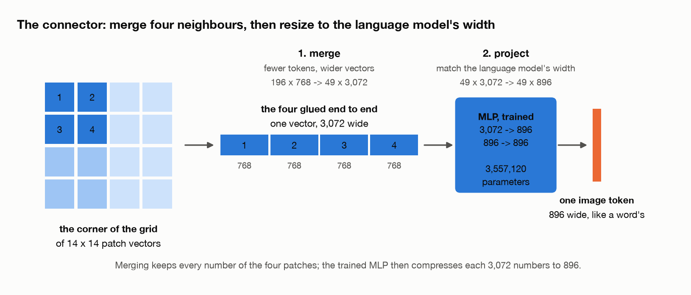{: .light width="1000" height="428" }
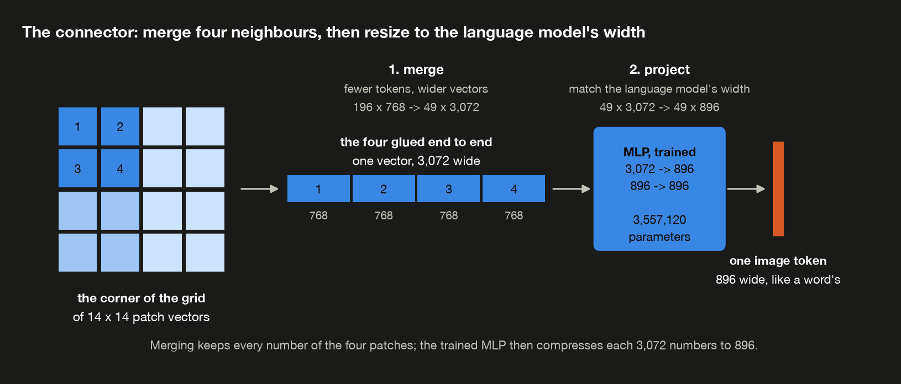{: .dark width="1000" height="428" }

**Step 1: merge four neighbouring patches into one.** Take each 2 × 2 block of neighbouring patch vectors and glue the four end to end: 4 × 768 = 3,072 numbers. The 14 × 14 grid becomes a 7 × 7 grid, so 196 vectors become 49. Nothing is averaged here: all four patches' numbers are still there, side by side, for the next step to use. What shrinks is the number of positions the language model has to read, and every position costs compute and KV cache memory, which [§8](#what-an-image-costs) puts a price on. Qwen2-VL's paper describes the same move: "a simple MLP layer is employed after the ViT to compress adjacent 2 × 2 tokens into a single token" (§2.1).

**Step 2: project each merged vector to the language model's width.** Each one goes through a small MLP of two layers: the first takes 3,072 numbers to 896, then a GELU (as in the encoder, and a close cousin of the SiLU in [post 1's FFN](/posts/llm-architectures-attention-and-rope/#the-ffn)), then the second takes 896 to 896:

`3,072 → layer 1 → 896 → GELU → layer 2 → 896`

This is where the vector shrinks: 3,072 numbers become 896, so the first layer has to learn which combinations of the four patches are worth keeping. What comes out is 896 wide, the width of one of Qwen's word embeddings. This two-layer shape is the one [LLaVA-1.5](https://arxiv.org/abs/2310.03744) found worked better than the single linear layer of the original [LLaVA](https://arxiv.org/abs/2304.08485) (§3.3).

The same step as a formula. Call one merged vector $h$, its 3,072 numbers in a row. The first layer has a learned matrix $W_1$, 3,072 × 896, and a learned list of 896 numbers $b_1$ added after it, called a **bias**. The second layer has its own $W_2$, 896 × 896, and $b_2$. The image token $z$ that comes out is

$$z = \mathrm{GELU}(h\,W_1 + b_1)\,W_2 + b_2$$

**How small is it?** Those four pieces are the whole connector. Counting their numbers:

| piece | shape | numbers |
|---|---|---|
| $W_1$ | 3,072 × 896 | 2,752,512 |
| $b_1$ | 896 | 896 |
| $W_2$ | 896 × 896 | 802,816 |
| $b_2$ | 896 | 896 |
| total | | **3,557,120** |

That's about 0.7% of the language model's 494,032,768 ([post 6](/posts/llm-architectures-lora/) counted them), and in stage 1 it's the only part that trains: SigLIP and Qwen stay frozen. Nothing teaches the encoder to see or the language model to read. The connector learns a small bridge between two models that already work.

**Why merge, if it makes the connector bigger?** Merging makes the first layer's input four times wider, 3,072 numbers instead of 768, so $W_1$ is four times bigger too. Without the merge, the connector would need 1.49 million parameters instead of 3.56 million. But the merge also cuts the number of image tokens Qwen has to process to a quarter:

| | with the merge | without the merge |
|---|---|---|
| connector parameters | 3.56M | 1.49M |
| image tokens | 49 | 196 |
| KV cache per image, bf16 | 0.57 MiB | 2.30 MiB |

So we spend about 2 million extra connector parameters, under half a percent of the language model, to make the picture's part of the sequence 75% shorter. It's a good trade because the two sides are used very differently. The connector turns each picture into image tokens once. Those tokens then go through every one of Qwen's 24 layers, and while it writes an answer, their keys and values stay in the KV cache, where every new word can attend to them. In this experiment, merging cut the cache per picture by 4× and made training steps about 3× faster, and accuracy didn't drop ([§8](#what-an-image-costs) has the run, and a caveat about it).

Checking the shapes and counts in code ([`the_connector`](https://github.com/bearbearyu1223/llm-architectures-refresher/blob/main/src/llmrefresher/demos/d07_multimodal.py)). The last two lines are the exact connector sizes behind the table's 3.56M and 1.49M:

<!-- RECEIPT: s2a -->
```text
  step                                          shape
  -----------------------------------------------------
  encoder output                    196 vectors x 768
  merge each 2 x 2 block           49 vectors x 3,072
  projector layer 1                      3,072 -> 896
  projector layer 2                        896 -> 896
  what the language model reads      49 vectors x 896
  one word's embedding, for scale      1 vector x 896

  projector parameters, after merge  3,557,120
    without the merge (768 in)       1,492,736
```


#### Where the picture goes {#where-the-picture-goes}

The step that makes it work is simple: the 49 image tokens are placed in the sequence where words would be.

<!-- FIGURE: sequence -->
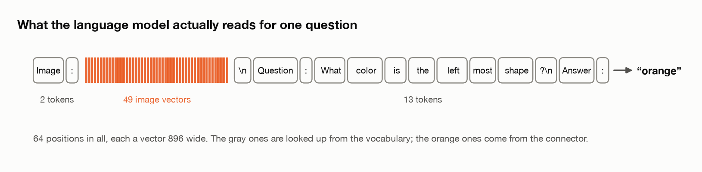{: .light width="1000" height="246" }
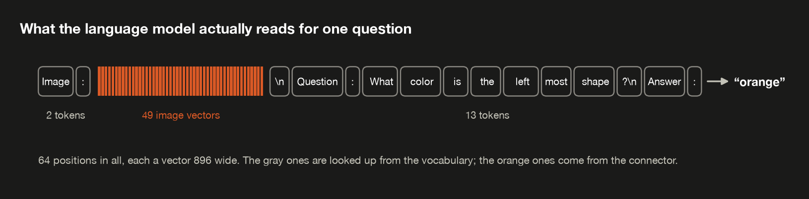{: .dark width="1000" height="246" }

The language model is given the vectors for `Image:`, then the picture's 49 vectors, then the vectors for the question's tokens, and asked to continue. The word vectors are looked up from Qwen's vocabulary table as always. The image tokens' vectors come out of the connector instead. From the language model's side they're all just positions in one sequence, and its attention treats them all the same way: the token `leftmost` can attend to an image position exactly as it would attend to an earlier word. Here are the positions for one question, counted by [`the_connector`](https://github.com/bearbearyu1223/llm-architectures-refresher/blob/main/src/llmrefresher/demos/d07_multimodal.py):

<!-- RECEIPT: s2b -->
```text
  piece         positions   kind
  --------------------------------
  'Image:'              2   text
  the picture          49  image
  the question         13   text
  TOTAL                64
```

**Inside the language model, the image positions obey the causal mask.** Image token 10 can read image tokens 1 to 9, but not 11 to 49, even though all 49 exist at once. That sounds like it would lose half the picture, but it doesn't: the "every patch reads every patch" of [§1](#inside-the-encoder) already happened in the encoder, so every image token carries information about the whole picture before the language model reads any of them.

**The language model gets no picture layout.** The 7 × 7 grid goes in row by row, and each image token gets an ordinary next position, exactly as the next word would. Nothing tells the language model that token 8 sits directly below token 1. Whatever it knows about where things are, it learns from what the encoder put inside the vectors. Real models often add the layout back: Qwen2-VL's version of RoPE, M-RoPE, gives each image token a height and a width position along with its place in time (§2.1).

**The picture is never turned into words.** There's no hidden caption in the middle. The language model gets 49 vectors that don't correspond to any word in its vocabulary, and has to learn, through the connector, to make sense of them.

---

### 3. Stage 1: learning to describe {#stage-one}

The model now has all its parts, and two of them already know a lot: the encoder knows what's in a picture, and the language model knows how to write. The connector between them knows nothing. It starts random, so the 49 vectors it hands the language model are noise. Qwen can take them in, since they're the right width ([§2](#the-connector)), but it has no idea what they mean.

So stage 1 asks one question: **can training only the connector teach a frozen language model to describe a picture?**

Training happens in two stages, the recipe [LLaVA](https://arxiv.org/abs/2304.08485) made standard:

<!-- FIGURE: training-stages -->
{: .light width="1000" height="517" }
{: .dark width="1000" height="517" }

**The task: picture in, caption out.** The model is shown a picture and the word `Caption:`, and its target is the caption: every shape, named left to right, like `a purple triangle, a red circle and a green triangle`. The encoder and the language model are both frozen; only the connector trains. LLaVA's paper calls this stage "pre-training for feature alignment", and describes it the same way: "we keep both the visual encoder and LLM weights frozen, and maximize the likelihood ... with trainable parameters θ = W (the projection matrix) only" (§4.2). Stage 2 ([§4](#stage-two)) then asks narrower questions, like "What color is the triangle?"

**Why captions first?** Because a caption is the most direct test of the connector's one job. The language model already knows how to write `a yellow circle`. It only needs to be handed vectors that make *that* the likely thing to write, and the only part allowed to change is the one producing those vectors. So stage 1 teaches the connector to speak the language model's language, without the language model learning anything that could cover for a bad connector.

**One training step**, for a batch of 16 pictures and their captions:

1. **Encode.** The frozen encoder turns each picture into 196 vectors. (Since it never changes, the demo runs it once per picture at the start and keeps the result, so in practice this step is a lookup.)
2. **Connect.** The connector merges and projects them into 49 image tokens, each 896 wide.
3. **Predict.** The frozen language model reads `Image:`, the 49 image tokens, `Caption:` and the caption, and at every caption position predicts the next token.
4. **Score.** The loss compares those predictions with the real caption.
5. **Update the connector.** The **gradient**, the signal that says which way to nudge each parameter, travels back through all 24 of the language model's frozen layers to the connector. Only the connector's numbers change.

Step 5 is the one that surprises people. Freezing a model doesn't stop the training signal passing through it; it only stops its weights changing. To know which way to nudge the connector, training has to know how the connector's output affected the loss, and that path runs through the language model. So a step costs a full forward and backward pass through the language model, as it did for LoRA in [post 6](/posts/llm-architectures-lora/), even though none of its weights change.

**How the loss is scored: teacher forcing.** In training, the model doesn't write a whole caption and get graded at the end. It's shown the right caption and, at every position, asked to predict the next token from the right tokens before it. This is called **teacher forcing**. For the caption `a red square`, where each word is one token:

| the model has read | it should predict |
|---|---|
| `Image:` [49 image tokens] `Caption:` | a |
| … `Caption: a` | red |
| … `Caption: a red` | square |
| … `Caption: a red square` | (end of text) |

All four predictions come out of one pass, because the causal mask already keeps each position from seeing what comes after it. The last target is the end-of-text token, so the model also learns where a caption stops. The **loss** is the average, over these positions, of −log(the probability the model gave the right token): how surprised it was by the right one ([post 6](/posts/llm-architectures-lora/#loss-and-exact-match) used the same loss). The picture and the prompt are context, and aren't scored.

**The actual run**, from [`stage_one`](https://github.com/bearbearyu1223/llm-architectures-refresher/blob/main/src/llmrefresher/demos/d07_multimodal.py) (lr is the learning rate, how big each nudge is):

<!-- RECEIPT: s3 -->
```text
  trained: the connector only        3,557,120 parameters
  frozen                             vision encoder and language model
  training                           400 steps x 16 captions, lr 0.001
  loss at step 1                     3.4778
  loss at the end (mean of last 10)  0.0534
  time per step                      1.01 s
```

The loss starts at 3.48, which means that, on average, the model gave the right next word of a caption a probability of about 3% (that's $e^{-3.48}$); it ends near 0.05, about 95% (that's $e^{-0.05}$). That's a big change, but it's a teacher-forced number: Qwen got much better at predicting the right word *when it's handed the right words before it*. It doesn't show that the model can write a right caption on its own, where every word it gets wrong becomes the context for the next. That takes a different test.

**Can it describe pictures it has never seen?** The test is free generation. The model is shown a new picture and `Caption:`, and writes: at each step it picks its most likely next token and feeds its own words back in, until it writes the end-of-text token (or runs two tokens past the right caption's length). A caption counts only if it matches the true one **exactly**: every shape, with the right color, in the right order. Naming the right shapes in the wrong order counts as wrong. So the score is the share of captions that are exactly right, not the share of pictures whose shapes the model recognized. From [`stage_one`](https://github.com/bearbearyu1223/llm-architectures-refresher/blob/main/src/llmrefresher/demos/d07_multimodal.py):

<!-- RECEIPT: s3r -->
```text
  Captions exactly right, of 120 new pictures each:

                    right picture  blank  wrong picture  no picture
  -------------------------------------------------------------------
  before stage 1                0      0              0           0
  after stage 1                91      2              0           0
    held-out pairs             63      0              0           0
```

Before training it gets **no** caption right. That's what a random connector should do: the language model is reading 49 vectors of noise. After 400 steps it gets **91 of 120** exactly right, on pictures it never saw.

The three control columns ask for the same caption with an all-white picture, with another test scene's picture, and with no picture at all, only the prompt. They say the 91 isn't luck. With a blank picture the model gets 2 captions right, and with another scene's picture, or with no picture at all, none. A caption names every shape and its position, so there's little to guess from: the model either reads the picture or fails. ([§5](#is-it-looking) uses the same controls on the questions, where they matter more.)

The last row is a second set of 120 test pictures, each with at least one of the three pairs no training picture had ([Setup](#the-pictures)). On those, it gets **63** right. A caption has to name every shape, so one unfamiliar pair is enough to make it fail. [§6](#pairs-never-seen) asks why.

**What the misses look like.** The first three test pictures, as the model writes them by free generation after stage 1 ([`stage_one`](https://github.com/bearbearyu1223/llm-architectures-refresher/blob/main/src/llmrefresher/demos/d07_multimodal.py)):

<!-- RECEIPT: s3b -->
```text
  truth: a red square
  model: a red square

  truth: a purple triangle, a red circle and a green triangle
  model: a purple triangle, a green triangle and a red circle

  truth: a blue circle, a yellow triangle and an orange circle
  model: a blue circle, a yellow circle and an orange triangle
```

Only the first is exactly right, and the two misses fail in different ways. The second names the right three shapes but puts two of them in the wrong order, a mistake about position. The third has the right colors in the right order and the right three shapes, but it says the yellow shape is a circle and the orange one a triangle, when it's the other way around. Seeing that there's yellow and seeing that there's a triangle isn't the same as knowing the triangle is the yellow thing. That's binding, from [Setup](#the-pictures), and the rest of the post keeps coming back to it.

**What stage 1 taught.** Remember what changed to get here: 3.6 million numbers in the connector. The encoder and the language model are bit-for-bit the models that were downloaded. The connector learned to hand Qwen vectors that make it write `a green square` when there's a green square in the picture, from 400 batches of examples. So in this controlled setting, the answer to stage 1's question is yes. But the third caption above shows what a good caption score can hide: the model saw yellow and saw a triangle without knowing which was which. Stage 2 asks about one shape at a time.

---

### 4. Stage 2: learning to answer {#stage-two}

Stage 1 taught the model to describe a picture. Shown three shapes, it writes `an orange circle, a yellow circle and a purple triangle`. But often we want one fact, not the whole description. Asked "What color is the triangle?", the answer should be just `purple`. Stage 2 teaches that: answering a question about a picture.

**What changes from stage 1?** Not the model. It's the same frozen encoder, the same connector and the same frozen language model, and in the standard recipe the connector is still the only part that trains. What changes is the training examples. In stage 1 each one was a picture and its caption; in stage 2 it's a picture, a question and a one-word answer:

| | the model reads | its target |
|---|---|---|
| stage 1 | `Image:` [49 image tokens] `Caption:` | `an orange circle, a yellow circle and a purple triangle` |
| stage 2 | `Image:` [49 image tokens] `Question: What color is the triangle? Answer:` | `purple` |

Training works the same way as in stage 1, with teacher forcing, and only the answer is scored. Stage 2 doesn't start from scratch: it takes the connector stage 1 trained and keeps training those same weights for another 400 steps, on 3,000 other pictures, each with one question.

That doesn't mean the model writes a caption and then reads it to find the answer. There's no caption anywhere in stage 2: the model gets the picture and the question, and writes the answer. Captioning was earlier practice for the connector, and whether that practice helps is what this section tests.

**Why might captioning help?** Because a caption already holds the answers. Take `an orange circle, a yellow circle and a purple triangle`:

| question | answer | where it is in the caption |
|---|---|---|
| "How many shapes are there?" | `three` | three shapes are named |
| "What color is the triangle?" | `purple` | the color right before "triangle" |
| "What color is the leftmost shape?" | `orange` | the first color, since captions go left to right |

To get that caption right, the connector had to hand over every shape, its color and its place, which is exactly what the questions ask about. But answering is a different job from describing. The model has to read the question, pick out the one part that matters and say it in one word: asked about the triangle, it has to give *its* color, not one of the circles'.

So this section asks: **does learning to describe pictures first help the connector learn to answer questions, or can stage 1 be skipped?**

**The three questions**, on pictures with two to four shapes ([Setup](#the-pictures)):

| question | asked as | what it needs |
|---|---|---|
| count | "How many shapes are there?" | noticing how many things there are |
| binding | "What color is the triangle?" (or circle, or square) | tying the right color to the right shape |
| leftmost | "What color is the leftmost shape?" | finding a shape by where it is |

Each is scored exactly right or wrong on 100 new pictures, in two sets. **Seen pairs** are pictures made only of color-shape pairs that appeared in training. **Held-out pairs** are questions about the three pairs no training picture ever had: a red triangle, a green circle and a blue square. Seen pairs measure how well the model does on new pictures made of familiar combinations; a high score there doesn't yet show it learned a rule that would carry over. Held-out pairs test exactly that, on combinations it never saw. This section reads mostly the first; [§6](#pairs-never-seen) is about the second.

**Four recipes**, built so each one isolates one ingredient. QA is short for question answering, the stage 2 task. These names are used everywhere from here on, in the text, the tables and the figures:

| recipe | training | why test it? |
|---|---|---|
| **Caption only** | 400 caption steps; no QA training | Can the caption-trained model already answer questions? |
| **QA only** | 800 QA steps from a randomly initialized connector | Can we skip stage 1 entirely? |
| **Caption → QA** | 400 caption steps, then 400 QA steps | Does caption pretraining help? |
| **Caption → QA + LoRA** | Same two stages, but also train a LoRA adapter in Qwen during QA | Does adapting the language model help further? |

QA only and Caption → QA both train only the connector. What sets them apart is whether the connector learned captions first. In the first three recipes, the encoder and the language model stay frozen throughout.

The QA-only recipe gets **800 steps**, as many as stages 1 and 2 together, so if it falls short it isn't for lack of training steps. It isn't a perfectly even comparison: it sees each training question about twice as often, and it never sees a caption. That second difference is the one being tested. The LoRA adapter is rank 8, on all seven kinds of matrix in the language model, exactly as in [post 6](/posts/llm-architectures-lora/#where-the-adapters-go): 4,399,104 more trainable parameters. Each trained version is run three times from different **seeds** ([Setup](#setup)), because post 6 learned the hard way that a difference between two single runs can be luck. Tables show the median of the three, with the lowest and highest in brackets.

The runs, from [`stage_two`](https://github.com/bearbearyu1223/llm-architectures-refresher/blob/main/src/llmrefresher/demos/d07_multimodal.py):

<!-- RECEIPT: s4a -->
```text
  batch                              16 questions, seeds 0, 1, 2

  model             starts from  steps  trainable  s/step
  ---------------------------------------------------------
  no stage 1             random    800  3,557,120    0.89
  connector only        stage 1    400  3,557,120    0.91
  connector + LoRA      stage 1    400  7,956,224    1.10
```

The scores, out of 100: for the trained recipes, the median of three seeds, with a thin line from the lowest to the highest.

<!-- FIGURE: stage-two-recipes -->
{: .light width="1000" height="484" }
{: .dark width="1000" height="484" }

Compare QA only with Caption → QA, the second and third groups in each panel. On seen pairs, both do well. On held-out pairs, captioning first looks much better, most of all on binding, 76 against 40, though the thin lines there are long. Counting is nearly perfect for every trained recipe. The exact numbers, from [`stage_two`](https://github.com/bearbearyu1223/llm-architectures-refresher/blob/main/src/llmrefresher/demos/d07_multimodal.py):

<!-- RECEIPT: s4b -->
```text
  task                 model   seen pairs  held-out pairs
  ---------------------------------------------------------
  count         stage 1 only            0               0
                  no stage 1  99 (97-100)      98 (94-99)
              connector only  98 (96-100)    100 (96-100)
            connector + LoRA  95 (94-100)      96 (94-99)
  binding       stage 1 only           32              25
                  no stage 1   94 (82-97)      40 (22-77)
              connector only  98 (95-100)      76 (40-81)
            connector + LoRA  99 (99-100)      76 (59-92)
  leftmost      stage 1 only           61              50
                  no stage 1   75 (65-93)      64 (58-77)
              connector only   88 (83-92)      82 (81-89)
            connector + LoRA   84 (83-89)      84 (83-93)
```

**Does captioning first help? On seen pairs, barely.** Trained on questions alone for 800 steps, the connector gets a median of **94** of 100 binding questions right; after 400 steps of captions and 400 of questions, it gets **98**. The QA-only runs spread wider, 82 to 97, but on pictures like the ones it trained on, a model that skipped the captions does nearly as well. That agrees with a finding at much larger scale: the [Prismatic VLMs](https://arxiv.org/abs/2402.07865) study found the connector-only first stage "unnecessary" for 7B and 13B models (§4.1).

**On held-out pairs, it may help a lot.** The binding column drops to **76** with stage 1 and **40** without. But read the brackets: the three runs without stage 1 scored 22 to 77, and the three with it 40 to 81. The ranges overlap, so three seeds can't settle it. [§6](#five-seeds) runs five more seeds, paired, and there stage 1 comes out ahead in all five.

**Counting is easy here, whichever way it's trained.** Every trained version gets almost all 100 right, a median of 95 to 99, including the one that never saw a caption. How many things there are is something the encoder's patch vectors carry plainly, and a connector trained on nothing but counting questions learns to pass it on. That's a statement about these pictures, two to four large shapes on white, not about counting in general.

**Position is the hardest of the three.** Leftmost scores lowest for every trained version, 75 without stage 1 and 84 to 88 with it, and its spread is the widest: the QA-only runs scored between 65 and 93 depending on the seed, which is why a single run would have told two different stories here.

**The Caption-only model can sometimes answer already.** Asked questions it was never trained on, the Caption-only model gets 32 binding and 61 leftmost questions exactly right, one word and nothing else, with no question training at all. These scores alone don't say whether it used the picture to get them; [§5](#is-it-looking)'s controls weren't run on this model. On counting it scores 0: it never answers with just the number.

**LoRA showed no consistent improvement.** With stage 1 done, letting the language model adapt through a rank-8 adapter scores 95 against 98 on counting, 99 against 98 on binding and 84 against 88 on leftmost. Every one of those differences is inside the spread of three seeds, so these runs can't tell a small effect from none. That's a result about these questions, not about LoRA in vision-language models, and it's narrower than "fine-tune the language model too", which is what LLaVA does. A likely reason is the questions: these have one-word answers and a fixed format, so once the connector hands over the right information, the frozen language model already knows how to say `purple`. Questions that need the language model to *reason* about the picture would give an adapter more to do, and [Idefics2](https://arxiv.org/abs/2405.02246)'s experiments found LoRA useful for exactly that kind of training at scale: "Leveraging LoRA still adds expressivity to the training and stabilizes it" (Finding 3).

**The loss and the scores can disagree.** Here's how the loss fell in each run. Loss is the number training pushes down, and it falls steadily in every run, including a stage 1 run that skips the 2 × 2 merge and reads all 196 patch vectors, which [§8](#what-an-image-costs) compares:

<!-- FIGURE: training-loss -->
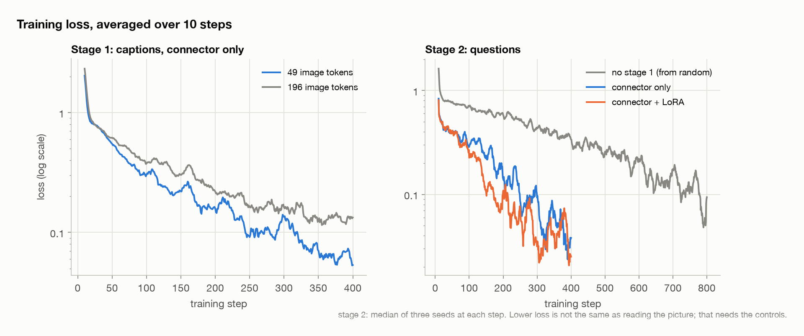{: .light width="1000" height="418" }
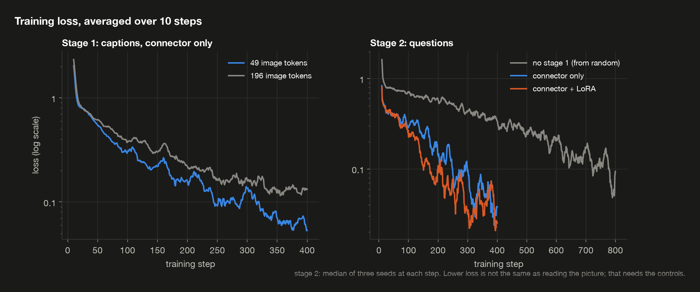{: .dark width="1000" height="418" }

A falling loss says the model got better at predicting the training answers. It doesn't say *how*, or whether that works on anything new. The QA-only model shows the difference: it learned to answer binding questions on seen pairs, 94 of 100, and still got only 40 on held-out pairs. A model can learn to predict the training answers without learning a rule that carries over to new combinations. It could even lower its loss by learning which answers are common, without reading the picture at all.

**What stage 2 showed.** On new pictures of familiar pairs, every trained recipe learned to answer, and captioning first barely mattered. On pairs the model never saw, captioning first looked like it helped a lot, most of all on binding, but three seeds can't settle that. Letting the language model adapt with LoRA showed no consistent gain. Stages 1 and 2 are the only training stages. From here on, the post tests what they produced, starting with whether the models look at the picture at all.

---

### 5. Is it actually looking? {#is-it-looking}

After stage 2, the trained models answer most questions about familiar pairs right. But a score on its own can't say whether a right answer came from the picture.

A model can get a question about a picture right without looking at it. These test pictures have two, three or four shapes, each a third of the time, so answering "three" to every counting question would already be right about a third of the time. And triangles came green or blue more often than any other color in training ([§6](#familiar-pairs) counts them), so a model could answer "What color is the triangle?" with a familiar color and be right more often than chance. This isn't only a worry for a tiny model: the [MMStar](https://arxiv.org/abs/2403.20330) authors found that on real benchmarks "visual content is unnecessary for many samples", with "more than 50% questions of ScienceQA" answerable by most language models that were never shown the picture (§1).

So this section changes the picture and keeps everything else the same. If the answers change when the picture does, the model was using it.

**The short answer:** the answers depend strongly on the picture. Take it away or swap it for another, and every trained model loses at least 59 points. But some right answers don't need the picture, and once the language model is trained with LoRA, it answers between a fifth and a third of the questions right with no picture at all.

This is a different question from §4's held-out pairs. Held-out pairs ask whether what the model learned carries over to new combinations. The checks here ask whether a right answer depended on the picture at all.

#### Four ways to ask the same question {#four-ways}

Every test question is asked four times, with exactly the same words. Only what the model sees changes:

<!-- FIGURE: four-controls -->
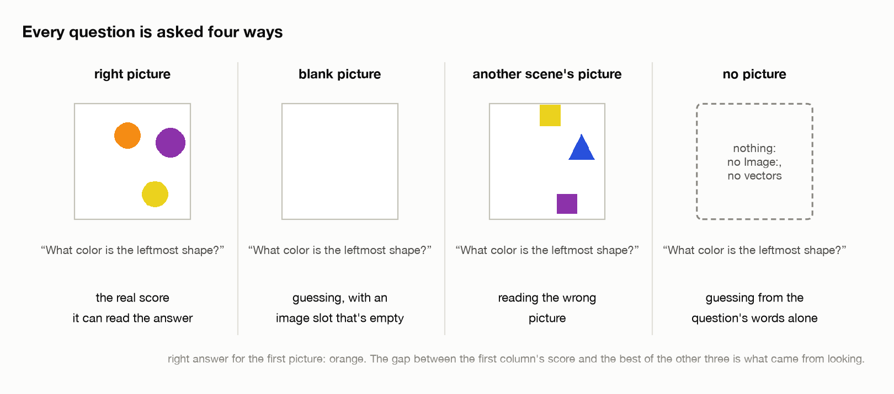{: .light width="1000" height="441" }
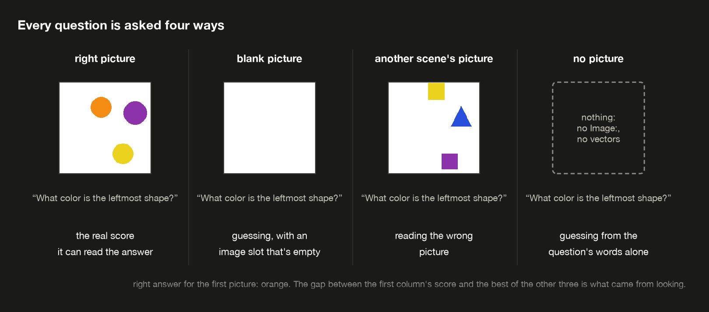{: .dark width="1000" height="441" }

| test | what the model gets | what it checks |
|---|---|---|
| **right picture** | the picture the question was written about, and the question | the normal test |
| **blank picture** | an all-white picture, and the question | what it answers with no shapes or colors to read |
| **wrong picture** | the next test scene's picture, and the question | whether the answer changes when the picture does |
| **no picture** | the question only | what it answers from the words alone |

In the figure, the question is "What color is the leftmost shape?" and the right answer is `orange`.

**A blank picture and no picture are not the same test.** With a blank picture, SigLIP still encodes an all-white image, the connector still turns it into 49 image tokens, and Qwen still reads them. They show no shapes, but they're still vectors, and they can push the answer around. With no picture, there's no `Image:` and no image tokens at all: Qwen reads only the question. That second one is the test MMStar ran.

**The wrong picture replaces the evidence instead of removing it.** The other scene in the figure has a yellow square on its left, so a model that reads the picture it's shown should say `yellow`. Every test is scored against the right picture's answer, `orange`, so `yellow` counts as wrong there, and that's intended: the column measures whether the original answer survives a change of picture. A right answer in that column is one the two scenes happen to share. To see whether the model reads the swapped picture correctly, the demo also scores each wrong-picture answer against the picture it was actually shown, below.

All four recipes from §4 get all four tests, including Caption only.

#### Measuring the difference: the gap {#the-gap}

To sum up how much the right picture helps, I'll use one number for this post and call it the **gap**. Write $A$ for the share of questions answered right, out of 100, and take the best of the three other tests:

$$\text{gap} = A_{\text{right picture}} - \max(A_{\text{blank}},\ A_{\text{wrong}},\ A_{\text{none}})$$

For example, Caption → QA gets 98 binding questions right with the right picture, 5 with a blank one, 29 with a wrong one and 0 with none. The best of those three is 29, so its gap is 98 − 29 = **69** points.

Taking the best of the three makes the gap deliberately conservative: the right picture has to beat every other way of asking, not just the weakest. The gap is a difference in accuracy, the part of the score that's lost when the picture is taken away or swapped. It isn't a measure of how much of the model's reasoning is visual.

#### What happened {#what-happened}

Each model, asked all four ways, from [`is_it_looking`](https://github.com/bearbearyu1223/llm-architectures-refresher/blob/main/src/llmrefresher/demos/d07_multimodal.py) (right answers out of 100; for the trained recipes, the median of three seeds):

<!-- FIGURE: stage-two-results -->
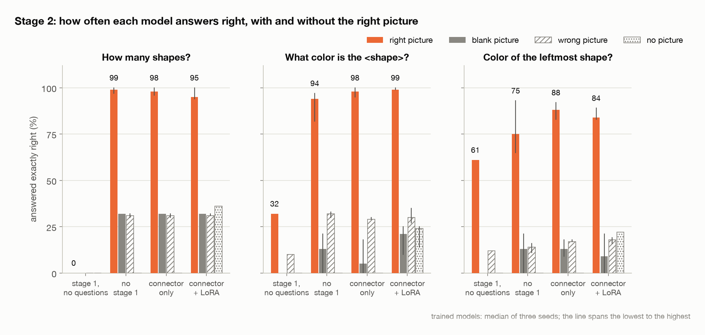{: .light width="1000" height="477" }
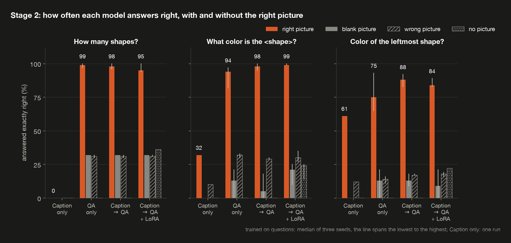{: .dark width="1000" height="477" }

The exact numbers:

<!-- RECEIPT: s5 -->
```text
  task                 model  right  blank  wrong  none  gap
  ------------------------------------------------------------
  count           no stage 1     99     32     31     0   67
              connector only     98     32     31     0   66
            connector + LoRA     95     32     31    36   59
  binding         no stage 1     94     13     32     0   62
              connector only     98      5     29     0   69
            connector + LoRA     99     21     30    24   69
  leftmost        no stage 1     75     13     14     0   61
              connector only     88     13     17     0   70
            connector + LoRA     84      9     18    22   62
```

**1. The right picture makes a big difference.** For every trained recipe and every question, the right picture beats the best of the other three tests by at least 59 points. That's strong evidence these models use the picture, and aren't reaching their scores by guessing from the question. It doesn't show that every right answer came from reading the picture, only that the picture matters a lot.

<!-- PENDING (rerun): Caption-only rows: its gap, and what that says about §4's "can sometimes answer already". -->

**2. A blank or wrong picture still gets some right.** All three trained recipes get 32 of 100 counting questions right with a blank picture. With two, three or four shapes a third of the time each, always giving the same number would score about a third, so 32 fits that kind of guess, though the demo doesn't record which number each model gives. On the two color questions, a blank picture scores between 5 and 21, around what picking one of six colors would get, about 17. On counting, the wrong picture scores 31: two scenes drawn independently have the same number of shapes about a third of the time, so a model that counts the picture it's shown would still get about that many right.

<!-- PENDING (rerun): wrong picture scored against both pictures (receipt s5b): how often each model gave the shown picture's answer vs the original's, on questions where they differ. This is the direct test of "the answer changes when the picture does". -->

So a right answer doesn't always mean the model used the picture the question was about.

**3. LoRA changes what happens with no picture at all.** With no image tokens, the two models whose language model stayed frozen, QA only and Caption → QA, score **0** on every question. Caption → QA + LoRA gets 36 counting, 24 binding and 22 leftmost questions right. One likely reason is that LoRA taught Qwen this task's short answer format during stage 2, so it can now produce `three` or `purple` from the question alone, as a guess from what was common in training. It's a small version of what the MMStar authors measured on real benchmarks, here after only 400 steps on a rank-8 adapter, and it's part of why this recipe has the smallest gap, 59 on counting.

<!-- PENDING (rerun): what frozen Qwen and the LoRA model actually wrote with no picture (receipt s5c); a 0 under exact match may be a format miss (e.g. "3"), not a lack of knowledge. -->

#### What this means for evaluating a VLM {#evaluating-a-vlm}

Two lessons, and they pull in different directions. This small VLM really does depend on the picture: take it away or swap it, and accuracy drops sharply. And accuracy alone can still mislead, because some questions can be answered by guessing, by habits from the training data, or by the language model alone.

That matters well beyond colored shapes. MMStar's abstract gives the starkest example: "GeminiPro achieves 42.9% on the MMMU benchmark without any visual input, and outperforms the random choice baseline across six benchmarks over 24% on average." GeminiPro there is the language model alone, listed among the paper's LLMs apart from GeminiPro-Vision, answering from each question and its answer options. Picking an option at random scores 22.1% on MMMU (Table 1). So when you evaluate a vision-language model, don't stop at whether it got the answer right. Ask whether it still would if the picture were missing, or different. The four tests here are a cheap, useful set of controls to include.

---

### 6. Pairs it never saw {#pairs-never-seen}

The models in §4 learned to answer questions about colored shapes. But did they learn to tie each shape to its own color, or mostly to remember which colors usually went with which shapes? On familiar pictures the two give the same answer, so this section tests them where they don't.

**Three combinations never appear in training: a red triangle, a green circle and a blue square.** Every color and every shape still does. The model sees red, green and blue things, and triangles, circles and squares, just never in those three pairings, in captions or in questions:

<!-- FIGURE: held-out-split -->
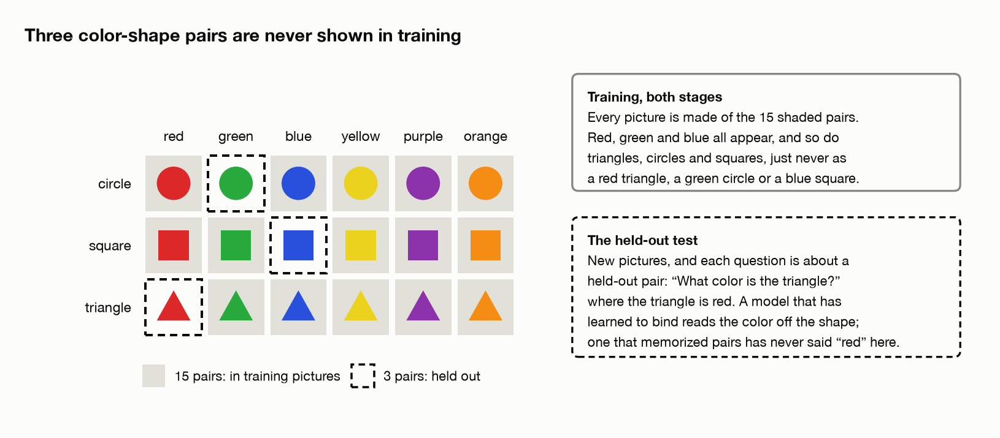{: .light width="1000" height="439" }
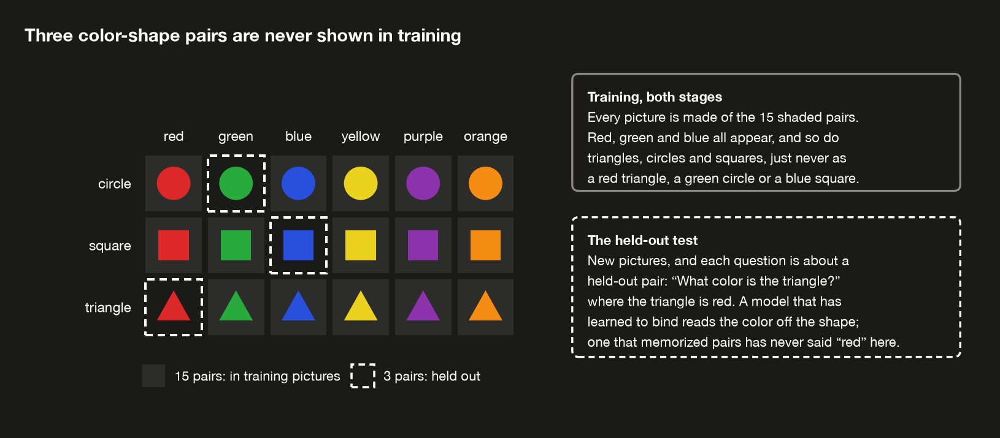{: .dark width="1000" height="439" }

That leaves two ways a model could answer "What color is the triangle?":

- **Remember familiar pairs.** Triangles came green or blue more often than any other color in training, since red was never allowed on them. A model leaning on that habit finds the triangle and picks a color it has seen on triangles before.
- **Read the picture.** Find the triangle, then read its color. That works whether or not the pair is familiar.

On familiar pairs, both give the same answer. On a held-out pair, only reading the picture gives `red`. So scoring well on held-out pairs is evidence that the model reads color and shape separately, in this setting. It isn't proof of a general skill: the pictures are simple, there are only 18 pairs, and a model can still pick up other regularities in them.

#### The first result, from three seeds {#held-out-first-result}

The demo asks 100 more questions of each kind, each one about a held-out pair: "What color is the triangle?" when the triangle is red, "What color is the leftmost shape?" when the leftmost shape is a green circle, and counting on pictures that contain at least one of the three. §5's four tests apply here too, and the gap is again the right picture against the best of the other three ([`pairs_never_seen`](https://github.com/bearbearyu1223/llm-architectures-refresher/blob/main/src/llmrefresher/demos/d07_multimodal.py)):

<!-- RECEIPT: s6a -->
```text
  never in a training picture        green circle, blue square, red triangle
  stage 1 captions with one in it    63 of 120 exactly right

  Right picture, median of the seeds. Control and gap are on the
  held-out questions, against the best of blank, wrong and none.

  task                 model  seen  held out  control  gap
  ----------------------------------------------------------
  count           no stage 1    99        98       37   61
              connector only    98       100       38   62
            connector + LoRA    95        96       47   49
  binding         no stage 1    94        40       13   27
              connector only    98        76       23   53
            connector + LoRA    99        76       25   51
  leftmost        no stage 1    75        64       26   38
              connector only    88        82       33   49
            connector + LoRA    84        84       35   49
```

**Binding drops, most of all for QA only.** QA only and Caption → QA did almost equally well on familiar pairs, 94 and 98. On held-out pairs they fall to **40** and **76**. That difference is what this section is about, but three seeds aren't enough to trust it: QA only's runs scored 22, 40 and 77, and Caption → QA's 40, 76 and 81, so one seed of each landed in the other's range.

**Counting doesn't care.** All three models count held-out pictures as well as familiar ones, 96 to 100. How many shapes there are has nothing to do with which color goes with which shape.

**Leftmost drops less.** 82 against 88 for Caption → QA, 64 against 75 for QA only, and nothing for Caption → QA + LoRA. A leftmost question doesn't name a shape, so there's less to trip over: the model finds the leftmost thing and reads its color, a color it has seen plenty of times on other shapes.

**Every model is still looking.** The gaps on held-out binding are 27, 53 and 51 points, so even QA only reads something from the picture. It just gives the wrong color more often.

#### Does captioning first help? Five paired seeds {#five-seeds}

To settle it, a second program, `uv run demo07 --followup`, runs the comparison again, more carefully ([`d07_followup.py`](https://github.com/bearbearyu1223/llm-architectures-refresher/blob/main/src/llmrefresher/demos/d07_followup.py)):

- **Five paired seeds.** Each seed trains its own stage 1, then three versions: **QA only** (800 steps of questions, connector from random), **Caption → QA** (stage 1, then 400 steps of questions), and **Caption → QA + captions**, the same as Caption → QA except that each step's 16 questions come with 4 captions mixed in. Within a seed, all three get the same questions in the same order. They still differ in their starting connector and in what else they trained on, but matching the questions removes one big source of run-to-run difference, so two versions from one seed can be compared directly.
- **Bigger, fresh tests.** 300 questions per test instead of 100, from seeds the main run never used.
- **No LoRA.** It showed no consistent gain in §4, so its place goes to Caption → QA + captions.

The scores, from [`run`](https://github.com/bearbearyu1223/llm-architectures-refresher/blob/main/src/llmrefresher/demos/d07_followup.py):

<!-- RECEIPT: f1 -->
```text
  Median of 5 seeds, range in brackets, right of 300. Control is the
  best of blank, wrong and no picture on held-out binding.

  model                  binding seen       held out     control
  ----------------------------------------------------------------
  no stage 1            273 (231-298)   107 (61-205)  36 (23-76)
  connector only        297 (286-300)  214 (140-237)  81 (44-98)
  connector + captions  282 (212-298)  206 (115-259)  81 (40-98)

  model                 leftmost seen       held out
  ----------------------------------------------------
  no stage 1            235 (204-260)  187 (165-239)
  connector only        271 (265-272)  241 (234-254)
  connector + captions  287 (279-288)  278 (264-293)
```

<!-- FIGURE: paired-seeds -->
{: .light width="1000" height="458" }
{: .dark width="1000" height="458" }

And seed by seed, also from [`run`](https://github.com/bearbearyu1223/llm-architectures-refresher/blob/main/src/llmrefresher/demos/d07_followup.py):

<!-- RECEIPT: f2 -->
```text
  Seed by seed, held-out pairs: how often one version beat another.

  version                      against      task  ahead in  median
  ------------------------------------------------------------------
  connector only            no stage 1   binding    5 of 5     +74
                                        leftmost    5 of 5     +53
  connector + captions  connector only   binding    2 of 5      -4
                                        leftmost    5 of 5     +31
```

**Caption → QA beat QA only on held-out binding in all five seeds,** by a median of 74 questions in 300, about 25 points. That's smaller than the 107 between the two medians, 214 and 107, and it's the better measure of the typical gain, because it compares runs that saw the same questions. The medians, 71% and 36%, are close to the main run's 76 and 40, and each sits far above its control, so all of the versions are looking. On held-out leftmost, Caption → QA was ahead in all five seeds as well, by a median of 53.

So the advantage is repeatable. That doesn't say *why*, which is what the rest of this section looks at.

**A side result: more captions in stage 2.** Mixing captions into stage 2 didn't help binding. Caption → QA + captions came out ahead of Caption → QA in 2 seeds of 5, by a median of −4, and one seed fell to 115. Whatever captions do for binding, they do it in stage 1. They did help the leftmost question, in every seed, 278 against 241 on held-out pairs. The likeliest reason is how captions are written: shapes go from left to right, so every caption starts with the answer to "what color is the leftmost shape?".

#### What does the model get wrong? {#where-wrong-answers-come-from}

Some of Caption → QA's wrong answers on held-out questions, from the main run's first seed ([`pairs_never_seen`](https://github.com/bearbearyu1223/llm-architectures-refresher/blob/main/src/llmrefresher/demos/d07_multimodal.py)):

<!-- RECEIPT: s6c -->
```text
  Some wrong answers, connector only, first seed (held-out questions):

  What color is the triangle?          right: red     said: yellow
  What color is the triangle?          right: red     said: yellow
  What color is the circle?            right: green   said: red
  What color is the circle?            right: green   said: red
  What color is the square?            right: blue    said: green
  What color is the leftmost shape?    right: blue    said: yellow
  What color is the leftmost shape?    right: red     said: orange
```

<!-- FIGURE: failures -->
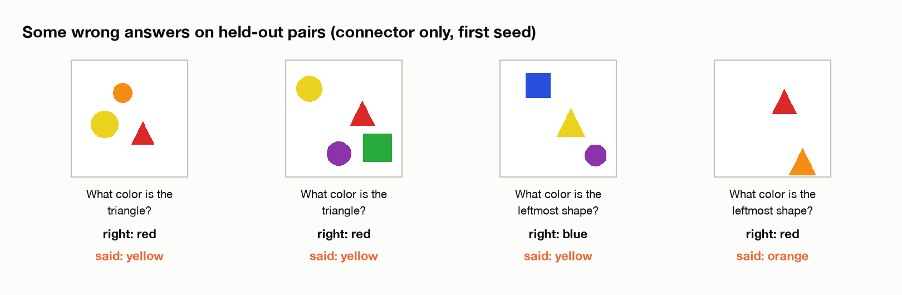{: .light width="1000" height="327" }
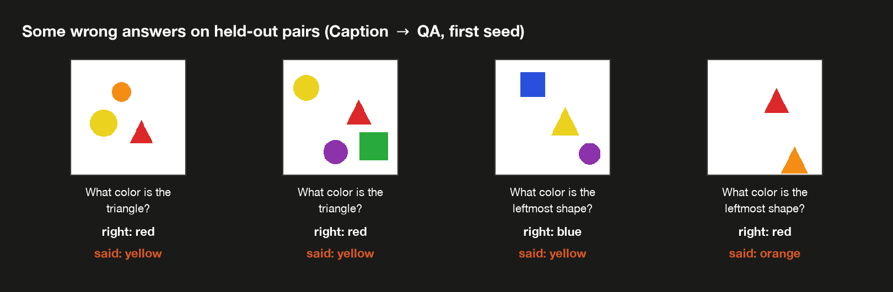{: .dark width="1000" height="327" }

Look at the pictures. Asked the color of the red triangle, the model said `yellow`, and there's a yellow circle in the picture. Asked the leftmost shape's color, it said `orange`, and there's an orange triangle beside it. It didn't produce a color from nowhere: it gave the color of another shape.

Over all five seeds of the follow-up, every wrong held-out binding answer is one of two kinds ([`wrong_color_sources`](https://github.com/bearbearyu1223/llm-architectures-refresher/blob/main/src/llmrefresher/demos/d07_followup.py)):

<!-- RECEIPT: f5 -->
```text
  Wrong held-out binding answers, all 5 seeds:

  model                 wrong  color in picture  not in it
  ----------------------------------------------------------
  no stage 1              944               814        130
  connector only          499               445         54
  connector + captions    512               502         10
```

- **A color that's in the picture, on another shape.** Most wrong answers are this kind, from 86% of QA only's to 98% of Caption → QA + captions'. The answer is the color of a shape other than the one asked about.
- **A color that isn't in the picture at all.** QA only did this 130 times, Caption → QA 54 and Caption → QA + captions 10. These can't come from taking another shape's color. They might come from a learned habit, from a color the vectors didn't carry clearly, or from the language model; the wrong answer alone can't say which.

#### Does it lean on familiar pairs? {#familiar-pairs}

Back to the habit from the top of this section. Holding three pairs out skews the training colors: the demo picks each shape's color first, then a kind that color is allowed to be, so red, green and blue each land on their two allowed kinds more often ([`training_colors`](https://github.com/bearbearyu1223/llm-architectures-refresher/blob/main/src/llmrefresher/demos/d07_followup.py)):

<!-- RECEIPT: f4 -->
```text
  How often each shape came in each color, over all training pictures:

  shape      red  green  blue  yellow  purple  orange
  -----------------------------------------------------
  circle    1411      0  1379     931     868     881
  square    1382   1368     0     939     918     921
  triangle     0   1420  1362     957     903     930
```

So for a triangle, the familiar colors are green and blue; for a circle, red and blue; for a square, red and green. If a model answers from habit, then when it gets a red triangle wrong, it should say green or blue more often than chance would. Here **chance** means picking one of the other shapes in the picture at random: for each wrong answer, the share of the other shapes that have a familiar color, added up over all the wrong answers ([`wrong_color_sources`](https://github.com/bearbearyu1223/llm-architectures-refresher/blob/main/src/llmrefresher/demos/d07_followup.py)):

<!-- RECEIPT: f6 -->
```text
  Of the wrong colors that were in the picture: did the color belong to
  the nearest shape, and was it one of the two colors this kind of shape
  came in most often in training? Beside each, what picking one of the
  other shapes at random would give.

  model                 in picture  nearest  chance  common  chance
  -------------------------------------------------------------------
  no stage 1                   814      506   523.2     378   303.2
  connector only               445      274   281.8     174   169.3
  connector + captions         502      313   320.0     150   177.7
```

Read the `common` columns first. QA only gave a familiar color 378 times, against 303 expected by chance, so it does lean on the habit. The two models trained on captions first don't: 174 against 169, and 150 against 178. Their wrong answers look like a random pick among the other shapes in the picture. These counts cover only the wrong answers whose color was in the picture.

The `nearest` columns test a different idea: that the model takes the color of the shape closest to the one asked about, measured center to center. Every model sits at or a little below chance there, so being close by doesn't explain the mistakes.

This is the clearest clue to *why* captioning first helps on held-out pairs: without it, the model falls back on the colors a shape usually came in. It doesn't prove that captions remove shortcuts, but it fits the five-seed result.

#### Where does the mistake begin? {#where-the-mistake-begins}

A wrong color could start in any of the three parts. SigLIP might not keep the triangle's color clearly, the connector might lose it, or Qwen might have it and still use it wrong. To look inside, the demo trains a **linear probe**: a tiny classifier that reads the vectors from one part of the model and tries to name a shape's color. The VLM itself stays frozen; only the probe learns. It averages the vectors under one shape into one vector, multiplies that by one trained matrix, and picks the color (or kind) with the highest score. It's trained on shapes from training pictures, which never include a held-out pair, and tested on shapes in held-out pictures. If even this simple reader can name a red triangle's color, the color is easy to get at in those vectors.

The probe reads three places: the encoder's output, the connector's output after stage 1, and Caption → QA's connector output after stage 2, both connectors from the first seed ([`probe`](https://github.com/bearbearyu1223/llm-architectures-refresher/blob/main/src/llmrefresher/demos/d07_followup.py)):

<!-- RECEIPT: f3 -->
```text
  read from               color: seen  held out  kind: seen  held out
  ---------------------------------------------------------------------
  encoder output (196)         100.0%     74.9%      100.0%     98.7%
  stage 1 connector (49)       100.0%     88.9%      100.0%     90.0%
  stage 2 connector (49)       100.0%     80.1%      100.0%     89.3%

  probe trained on                   7,474 shapes in training pictures
  tested on                          670 seen-pair, 542 held-out-pair shapes
```

On familiar pairs, every place gives color and kind perfectly. On held-out pairs, color falls to 74.9% at the encoder's output, where guessing one of six colors would get about 17%. So even the frozen encoder doesn't keep color fully apart from shape: a reader that learned "red" from circles and squares misses a red triangle a quarter of the time. After stage 1, color is easier to read off the connector's output, 88.9%, though kind gets a little harder, 98.7% to 90.0%. After stage 2's questions, color drops back to 80.1%.

So caption training changed the connector's vectors in a way that made color easier for a simple linear reader to recover. That isn't a measure of how much color information is in them: a more powerful reader might find more. Nor is the probe's score on the same footing as the model's. For the same seed, Caption → QA answered 237 of 300 held-out binding questions right, 79%, close to the probe's 80.1%, but the probe scores every held-out-pair shape and the question scores one shape per picture. What the probe does suggest is that part of the problem is already in the vectors Qwen receives, not only in how Qwen uses them.

#### What this section showed {#pairs-what-we-learned}

**Captioning first helps on combinations the model never saw.** Caption → QA beat QA only on held-out binding in all five paired seeds, by a median of about 25 points. On familiar pairs the two looked almost the same, which puts the Prismatic finding from §4 in a different light: a first stage can look unnecessary when the test only checks familiar combinations.

**The wrong answers point to one reason.** QA only's mistakes lean toward the colors a shape usually came in during training; the models trained on captions first don't. Why captions would do that is a guess: a caption names every shape with its own color, in order, so getting captions right rewards keeping each shape's color separate, where a single question can often be answered by habit. The evidence here fits that guess but doesn't prove it.

**The probe adds a different clue.** After stage 1, held-out colors are easier to read off the connector's vectors than off the encoder's, and some of that is lost again in stage 2.

None of this shows how the connector represents color and shape, or that it learned a general rule for binding them. But it's more than one accuracy number: a gain that repeats across seeds, a different pattern of mistakes, and a change in how easily color can be read from the vectors, all from training a 3.56-million-parameter connector.

---

### 7. Text, a picture, or both {#text-pictures-or-both}

Every example so far had one picture followed by one question. Real use is more varied: a question with no picture, one picture, or two pictures to compare. Does the model need different machinery for each? And now that it has learned to read pictures, has anything changed in how it reads plain text? This section takes those two questions in turn, then asks what being able to take two pictures does and doesn't mean.

#### One sequence for text and pictures {#one-sequence}

No new machinery is needed, because Qwen only ever reads one sequence of vectors ([§2](#where-the-picture-goes)). The two kinds of input reach it by different paths. A text token is looked up in Qwen's vocabulary table. A picture goes through SigLIP and the connector and comes out as 49 vectors. Both kinds are 896 wide, so they can be laid end to end in whatever order the input has them:

<!-- FIGURE: input-mixes -->
{: .light width="1000" height="394" }
{: .dark width="1000" height="394" }

- **Text only.** No picture, so SigLIP and the connector aren't run at all. What's left is Qwen reading text, as it would on its own.
- **One picture and text.** The format every training example used.
- **Two pictures, or more.** Each picture adds its own 49 vectors wherever it appears, with its own `Image:` label in front. Nothing in Qwen limits how many, only the length of sequence it can handle and the memory [§8](#what-an-image-costs) puts a price on.

Matching the width only makes the image tokens something Qwen can take in. Training the connector is what makes them mean something to it ([§2](#the-connector), [§3](#stage-one)).

The demo's [`interleave`](https://github.com/bearbearyu1223/llm-architectures-refresher/blob/main/src/llmrefresher/vlm.py) builds any of these from a list of text and pictures. What each costs in positions ([`text_pictures_or_both`](https://github.com/bearbearyu1223/llm-architectures-refresher/blob/main/src/llmrefresher/demos/d07_multimodal.py)):

<!-- RECEIPT: s7t -->
```text
  input                  positions  from pictures
  -------------------------------------------------
  text only                     10              0
  one picture and text          62             49
  two pictures and text        114             98

  Text only, post 4's passage: perplexity after each kind of training
  (lower is better; median of the seeds, range in brackets):

  model                          passage perplexity
  ---------------------------------------------------
  Qwen2.5-0.5B as downloaded                20.8706
  no stage 1                                20.8706
  connector only                            20.8706
  connector + LoRA            20.8921 (20.88-21.14)

  >> Text alone is just the language model's ordinary input. Where the
     language model stayed frozen, its text is exactly what it was; only
     the arm that trains LoRA adapters can change it.
```

Every picture here is 224 × 224, so it always becomes 196 patches and, after the merge, 49 positions, whatever it shows. The rest is text. The question is 10 tokens, 11 with the line break before it when a picture comes first, and each `Image:` label is 2 tokens, 3 with its own line break. So one picture and text comes to 2 + 49 + 11 = 62, and a second picture adds 3 + 49 = 52, for 114. The question here is shorter than §2's, which is why one picture and text comes to 62 positions rather than 64.

#### What happened to Qwen's text? {#what-happened-to-text}

Training taught the model to read pictures. Did that cost anything on plain text? The demo scores each model's **perplexity**, how surprised it is by each next token of ordinary text ([post 4](/posts/llm-architectures-quantization/)), on post 4's passage, the same 550 tokens of prose [post 6](/posts/llm-architectures-lora/#what-it-forgot) used to see what fine-tuning disturbed. Lower is better:

<!-- PENDING (rerun): split s7t; the perplexity table goes here as its own receipt (s7p). -->

**Where Qwen stayed frozen, nothing changed.** QA only and Caption → QA score 20.8706, the same as the downloaded model to every digit printed, and that's guaranteed rather than lucky. Their training changed only the connector, and with no picture the connector isn't used: the same text goes in, through the same weights, in the same way, so the same predictions come out. The guarantee comes from that identical computation, not from the word "frozen" alone. Change the prompt format, the tokenizer or how positions are numbered, and text-only outputs could change even with Qwen's weights untouched.

**The LoRA model is different.** Caption → QA + LoRA trained an adapter inside Qwen during stage 2, so its computation on text changed too. On this passage, its median perplexity rose a little, to 20.89, with the three seeds between 20.88 and 21.14. That's small, and one 550-token passage can't say whether it reflects any real loss of language ability; that would take a broader text evaluation. It's in the same direction as post 6's adapters, which moved the same passage to between 20.93 and 25.39. And in [§4](#stage-two), LoRA showed no consistent improvement on the picture questions.

So for this small VLM, keeping Qwen frozen was the better trade: the model learned to use pictures, and its text-only predictions provably didn't move. That's a big reason so many recipes keep the language model frozen for the first stage, and some keep it frozen throughout. Train it, and its text behavior has to be measured, on more than one passage, rather than assumed.

#### Taking two pictures isn't understanding them {#two-pictures}

`interleave` can build a sequence with two pictures, but being able to take an input isn't the same as knowing what to do with it. Every training example was one picture followed by one question. The model never had to work out which picture a question means, or compare two.

So the demo asks each trained model three things: a text-only question, a question about one picture, and a question about two pictures that it was never trained on, "Which picture has a triangle, the first or the second?", where only the first one has a triangle ([`text_pictures_or_both`](https://github.com/bearbearyu1223/llm-architectures-refresher/blob/main/src/llmrefresher/demos/d07_multimodal.py)):

<!-- PENDING (rerun): receipt s7m, what each model wrote for the three inputs, and what it shows. -->

Real models train on exactly the kind of example this one never saw. Qwen2-VL's paper shows one in its data format: two pictures, each wrapped in `<|vision_start|>` and `<|vision_end|>`, then "What do the two pictures have in common?" (§2.2.1). Those special tokens "are inserted at the start and end of the image feature sequence to demarcate the image content" (§2.2.1), where this post uses the plain word `Image:`. [Flamingo](https://arxiv.org/abs/2204.14198) was designed to "handle sequences of arbitrarily interleaved visual and textual data" (abstract), and trained on web pages where pictures and text alternate. The same idea stretches to video: Qwen2-VL samples "each video at two frames per second" and turns the frames into tokens much as it does pictures (§2.1).

The idea carries over at any scale: once a picture is vectors the language model can read, text and pictures share one sequence. The hard part isn't building that sequence. It's training the model to know what the pieces mean and how they relate.

---

### 8. What an image costs {#what-an-image-costs}

This post's model turns one 224 × 224 picture into 49 tokens for Qwen. Without the 2 × 2 merge, the same picture would be 196 tokens: four times as many positions for the language model, from exactly the same pixels. What do those extra positions cost, in memory and in time? And does cutting them hurt accuracy?

#### How much memory one picture takes {#image-memory}

[Post 2](/posts/llm-architectures-kv-cache/) measured the **KV cache**: the keys and values a model keeps for every position it has read, so it doesn't recompute them for each new token it writes. Image tokens go through the same layers as text tokens, so they take the same space in the cache as any text token. For Qwen2.5-0.5B, that space is fixed for each token: keys and values, for each of 24 layers, for each of its 2 key/value heads, 64 numbers each, at 2 bytes per number in bf16:

$$\begin{aligned}
&\underbrace{2}_{\text{K, V}} \times \underbrace{24}_{\text{layers}} \times \underbrace{2}_{\text{heads}} \times \underbrace{64}_{\text{dims}} \times \underbrace{2}_{\text{bytes}} \\
&= 12{,}288 \text{ bytes} = 12 \text{ KiB per token}
\end{aligned}$$

So a picture's cache is 12 KiB times its number of tokens. The demo's first test picture is one red square ([`what_an_image_costs`](https://github.com/bearbearyu1223/llm-architectures-refresher/blob/main/src/llmrefresher/demos/d07_multimodal.py)):

<!-- RECEIPT: s8a -->
```text
  KV cache per token, in bf16        12,288 bytes
    = 2 (K and V) x 24 layers x 2 heads x 64 dims x 2 bytes

  the same picture as   tokens  KV cache
  ----------------------------------------
  196 patch vectors        196  2.30 MiB
  49 merged vectors         49  0.57 MiB
  its caption in words       3  0.04 MiB
  caption: "a red square"
```

Merging cuts the picture's cache by 75%, from 2.30 MiB to 0.57 MiB. With a fixed picture size and a fixed number of tokens, as here, that cost doesn't depend on what's in the picture. Its caption, `a red square`, is 3 tokens, so the picture takes sixteen times as many positions as its description, 65 times without the merge. The caption isn't a substitute for the picture, though: it names the square and leaves out everything a different question might need.

That's small per picture for a 0.5B model, but it adds up the way post 2's cache did: ten pictures at 196 tokens hold 23 MiB of cache for the pictures alone, against 5.7 MiB merged, and the cost per token grows with the model. These are the image tokens' cache only, during generation. They leave out the text, the model's weights, and, in training, the activations, gradients and optimizer state.

Memory isn't the only cost, and the costs don't all grow the same way. The cache grows in step with the number of tokens. Reading the picture in the first place compares every position with every other, which grows with the square of the sequence length ([post 3](/posts/llm-architectures-flash-attention/)). And every word the model writes afterwards reads all of the picture's positions again.

#### What the merge bought {#what-the-merge-bought}

To measure it, the demo trains stage 1 again on all 196 patch vectors: same seed, same data, same 400 steps ([`what_an_image_costs`](https://github.com/bearbearyu1223/llm-architectures-refresher/blob/main/src/llmrefresher/demos/d07_multimodal.py)):

<!-- RECEIPT: s8b -->
```text
                             49 tokens  196 tokens
  --------------------------------------------------
  connector parameters       3,557,120   1,492,736
  captions right, of 120            91          76
  final loss (last-10 mean)     0.0534      0.1331
  seconds per step                1.01        3.03

  LLaVA-1.5: 336 px, 14 px patches   (336 / 14)^2 = 576 tokens

  The same patches at a higher resolution (tokens, and KV cache in bf16):

  picture       patches  KV cache  merged 2 x 2  KV cache
  ---------------------------------------------------------
  224 x 224 px      196  2.30 MiB            49  0.57 MiB
  448 x 448 px      784  9.19 MiB           196  2.30 MiB
```

**The merged model trained three times faster,** 1.01 seconds a step against 3.03, even though its connector is the bigger one, 3.56 million parameters against 1.49 million. The connector is small next to the language model either way, and the language model now reads 49 image positions instead of 196. That's the trade from [§2](#the-connector) measured: a bigger connector, and a cheaper model overall.

**It also captioned better,** 91 of 120 against 76, with a lower final loss. But that doesn't show merging improves accuracy. Look at the first row: merging glues four 768-wide patch vectors into one 3,072-wide vector, which makes the connector's first layer four times bigger. So this comparison changed two things at once, the number of tokens and the size of the connector, and from one seed it can't say which mattered, or whether the gap is just run-to-run variation. What it does show is narrower: in this run, a quarter of the tokens came with no accuracy penalty.

<!-- PENDING (capacity run): receipt s8c, the three connectors at three seeds (49 tokens, 196 tokens, 196 tokens with a wider MLP at the merged size), and what it says about tokens vs connector size. -->

#### Bigger pictures {#bigger-pictures}

Every picture here is 224 × 224. SigLIP cuts pictures into 16-pixel patches, so doubling the picture's side to 448 pixels quadruples the patches, to 784, and the cache with them. The last table in the receipt above is that calculation, not a run: this post's SigLIP takes 224-pixel pictures only. Even merged, a 448-pixel picture would be 196 tokens, as many as this post's unmerged one.

Real models use far more tokens per picture than this one. LLaVA-1.5's encoder takes 336-pixel pictures in 14-pixel patches, which is $(336/14)^2 = 576$ tokens per picture, the middle line of the receipt above. Sharper pictures generally mean more tokens, and how much that costs depends on the design, which is why so much effort goes into cutting the count: Qwen2-VL's 2 × 2 merge, which this post copies, [SmolVLM](https://arxiv.org/abs/2504.05299)'s "pixel shuffle", which merges each r × r block of patches like §2's merge and so cuts tokens "by a factor of r²" and finds small models "benefit from more aggressive visual token compression", and the learned summaries of [§9](#other-designs). Qwen2-VL also lets the number of tokens vary with the picture's size instead of fixing it.

The trade-off is always the same shape: more visual tokens can keep finer detail, small objects or text in a photo, but every one is more work for the language model.

#### What this section showed {#image-cost-what-we-learned}

The 2 × 2 merge cut each picture from 196 tokens to 49 and its cache by 75%. In this run, it also made training three times faster, despite a connector more than twice the size, with no accuracy penalty. That doesn't mean fewer tokens are always better: squeeze too hard and the detail a question needs is gone. But it shows where an image's cost comes from: not its pixels, but how many tokens the language model is asked to read. And merging is only one way to control that, which is where [§9](#other-designs) picks up.

---

### 9. Other ways to connect a picture {#other-designs}

This post's model takes SigLIP's 196 **patch vectors**, 768 wide, passes them through a small connector, and puts the 49 **image tokens** that come out, 896 wide, into Qwen's input sequence. It works, but it isn't the only way. Every VLM has to answer the same question: **how does the picture's information reach the language model?** The published designs answer it in four main ways, and what separates them is what happens to the picture:

<!-- FIGURE: connector-designs -->
{: .light width="1000" height="785" }
{: .dark width="1000" height="785" }

**1. Project every patch into the sequence.** This post's design. An encoder turns the picture into patch vectors, a connector makes them the language model's width, and they go into the input sequence beside the words. [LLaVA](https://arxiv.org/abs/2304.08485) did the same with "a simple linear layer" (§4.1) on a frozen CLIP encoder, and its two training stages are the ones [§3](#stage-one) follows. The one difference is that LLaVA's second stage trained its whole language model, "continue to update both the pre-trained weights of the projection layer and LLM" (§4.2), where this post tried a LoRA adapter. [Qwen2-VL](https://arxiv.org/abs/2409.12191) uses the same 2 × 2 merge and goes further on size: it can "dynamically process images of varying resolutions into different numbers of visual tokens" (abstract). The appeal is simplicity: there are no new layers inside the language model, which reads the picture with the layers it already has. The cost is sequence length, which grows with the picture, and that's exactly what [§2](#the-connector)'s merge and [§8](#what-an-image-costs)'s numbers are about.

**2. Summarize with learned queries.** What if the language model shouldn't get every patch? A small set of learned vectors, called **queries**, can attend to all the patches and gather what's useful into a few outputs. Think of each query as a trained request for information; nothing makes it match a question a person would ask, like "what color is the triangle?". [BLIP-2](https://arxiv.org/abs/2301.12597)'s Q-Former uses "32 queries" (§3.1), and their outputs, projected to the language model's width, are "prepended to the input text embeddings" as "soft visual prompts" (§3.3). [Flamingo](https://arxiv.org/abs/2204.14198)'s Perceiver Resampler "produces a fixed number of visual outputs (64)" (§2.1), and its cross-attention layers, design 3, then read them. The two modules are built and trained differently, but they share the idea: the number of outputs stays the same however many patches there were. [Idefics2](https://arxiv.org/abs/2405.02246) found that this kind of learned pooling, cutting 729 visual tokens to 64, "increases the performance by 8.5 points on average" (§3.3). The risk is the other side of the same choice: a few outputs have to carry everything, and fine detail can get lost.

**3. Let the language model attend to the picture.** Here no image tokens join the text sequence. The vision side's output vectors stay outside it: in Flamingo, the resampler's 64 outputs from design 2. New **cross-attention** layers go between the language model's own layers, and through them the text positions attend to those vectors, while the original layers can stay frozen. The picture never takes a position in the sequence, but it still shapes every layer after the first cross-attention layer. Flamingo starts each new layer switched off: its output is multiplied by $\tanh(\alpha)$, with $\alpha$ "initialized to 0" (§2.2), so at the start the model is exactly the text model it began as. Meta's [Llama 3 vision models](https://arxiv.org/abs/2407.21783) apply cross-attention "after every fourth self-attention layer" (§7.2) and leave the language model as it was: "we intentionally do not update the language-model parameters" (§2). The cost is new machinery: extra layers, their parameters, and training that teaches the model to use them.

**4. Turn the picture into token IDs.** The first three all hand the language model continuous vectors from an encoder. [Chameleon](https://arxiv.org/abs/2405.09818) instead turns a picture into discrete tokens, the way a text tokenizer turns words into IDs. Each token is the nearest entry in a learned list of 8,192 image pieces, a **codebook**, and a 512 × 512 picture becomes 1,024 tokens (§2.1). Text tokens and image tokens then go into one sequence for one model, trained on both together from the start. Because it's trained to predict image tokens as well as text, Chameleon can also generate pictures. That comes from the training, not from using discrete tokens alone. The cost is that every picture has to fit a fixed vocabulary of codes, and one model has to learn both kinds of token.

#### Which is best? {#which-design-is-best}

| design | what happens to the picture | main advantage | main cost | examples |
|---|---|---|---|---|
| 1. project patches | its vectors join the text sequence | simple; no new layers in the language model | the sequence grows with the picture | this post, LLaVA, Qwen2-VL |
| 2. learned queries | a few learned queries summarize it | a small, fixed number of outputs | a few outputs can lose detail | BLIP-2, Flamingo |
| 3. cross-attention | it stays outside the sequence; new layers read it | uses no sequence positions; original layers can stay frozen | new layers to add and train | Flamingo, Llama 3's vision models |
| 4. token IDs | it becomes tokens from a codebook | one model for text and pictures, including generating them | a fixed codebook; one model learns both | Chameleon |

The designs can be combined, too: Flamingo uses 2 and 3 together.

There's no single winner. Idefics2's most useful finding is a conditional one: a cross-attention design "performs better than the fully autoregressive one when unimodal pre-trained backbones are kept frozen", but once the backbones are trained too, putting the picture in the sequence wins (Finding 2). The backbones are the encoder and the language model, and "fully autoregressive" is design 1. This post's frozen-backbone, small-scale setup is exactly where design 3 might have done better, and that's a fair caveat on everything above.

Building this one made the trade-offs concrete. With SigLIP and Qwen frozen and 3.56 million trained numbers, the model learned to answer questions about pictures. But every picture cost positions in the sequence ([§8](#what-an-image-costs)), shrinking them took a bigger connector ([§2](#the-connector)), and matching the width didn't by itself make the vectors mean anything ([§7](#one-sequence)). The other designs are different answers to the same problems: what to keep of the picture, how the language model gets at it, and what has to be trained so that it uses it.

---

### 10. What follows from all this {#what-follows}

Seven things, in the order the post found them.

1. **A picture is just more vectors.** A vision encoder turns patches into vectors the way an embedding table turns tokens into vectors, and after that it's a transformer like any other. Nothing about the language model had to change to read a picture.
2. **The connector is the whole adaptation.** 3.6 million trained parameters, about 0.7% of the language model, were enough to get captions exactly right 91 times in 120. The two big models stayed exactly as they were downloaded.
3. **Familiar test pictures hide what training did.** On pairs seen in training, every trained version answered 94 to 99 binding questions in 100, with or without the captioning stage. Only pairs it had never seen told them apart: 76 with captions first, 40 without, and five paired seeds put stage 1 ahead in all five.
4. **The failures were mostly binding failures.** On held-out pairs, 86% to 98% of wrong colors, depending on the model, were the color of another shape in the same picture. Only the model without stage 1 leaned toward the colors a shape usually came in, and a linear probe found part of the problem already in the vectors the language model reads.
5. **LoRA was the smallest lever here.** It moved no score beyond the spread between seeds, and it was the only version that could answer with no picture at all. That's a statement about one-word answers on simple pictures, not about LoRA in general.
6. **Controls are part of the result.** A blank picture still answered counting questions right 32 times in 100. Without that column, a 50% score would look like partial vision instead of a guess.
7. **Tokens are the cost.** Every picture is a fixed number of positions in the sequence and the KV cache, and the field's designs are largely different answers to how few positions a picture can be squeezed into.

And three limits, stated plainly. The pictures are generated shapes, much easier than photographs, so the scores say how the mechanism behaves, not how good the model is. Everything is one small language model and one small encoder, trained for minutes. And the encoder was frozen throughout, so this post says nothing about what training it would add, which some large models do ([Llama 3](https://arxiv.org/abs/2407.21783) trains its image encoder, §7.2).

---

### 11. Sidebar: the probe {#sidebar-the-probe}

One question to close on, the kind this material gets asked, and what separates an answer that sounds right from one that is.

> **"We attached a vision encoder to our language model and fine-tuned it on question-answer pairs about our product photos. It scores 90% on our test set. Is it ready?"**

**The tempting answer:** *"90% is good. Ship it, and fine-tune more if users find problems."*

A score alone can't answer this, and there are four things to check before it means anything.

**1. Score it without the picture.** Ask every test question again with a blank image, with another item's photo, and with no image at all. If the blank-picture score is high, the model is answering from the question's wording, and the 90% is partly a measure of how predictable your questions are. This post's §5 does this for every number it reports, and real benchmarks fail it: MMStar found more than half of one benchmark's questions answerable with no picture at all. The useful number is the gap between the right picture and the best control, not the score.

**2. Break the score down by what the question needs.** One average hides everything. Here, three questions about the same pictures behaved completely differently: counting was learned almost however the model was trained, while binding a color to a shape held up on unfamiliar pairs only if the model had first learned to describe pictures. A model that's 90% overall can be near-perfect on "what color is it?" and near-chance on "which one is on the left?", and your users will find the second kind.

**3. Test on combinations it never trained on.** If the test photos are new shots of the same products in the same settings, a model can score well by remembering which answers go with which products. Hold some combinations out of training on purpose, say a product never shown in one of its colors, and test on those. Here, binding scored 98 on familiar color-shape pairs and 76 on held-out ones, and 40 for a model trained without the captioning stage, which looked as good as the others on familiar pairs.

**4. Read the failures before training more.** A VLM has three parts and a wrong answer can come from any of them: the encoder may not represent the detail, the connector may not pass it on, or the language model may not use it. More question-answer data trains the last two at best. Reading the wrong answers is how you tell which. In §6, most wrong colors were the color of another shape in the same picture, which looks like a failure to tie a color to its shape. But a linear probe showed part of it was already in the encoder's vectors, and mixing more captions into training didn't fix it. And research on much larger models ([*Vision language models are blind*](https://arxiv.org/abs/2407.06581)) finds the encoders often hold information the language model fails to use.

What the question is really testing is whether "90% on our test set" is being read as "it understands the photos", or as what it is: a number that means little until you know what the model scores without looking.

### What's next {#whats-next}

Post 8 is **RLHF**, reinforcement learning from human feedback. Every example this post trained on came with one right answer to copy: `three`, `red`, or a caption like `a red square`. The loss only had to measure how far the model's next word was from that answer. Most of what people want from a chat model doesn't come in that form. There's no single correct reply to "explain this error message", only replies that people judge better or worse. RLHF trains on those judgments instead. People compare two replies and pick the better one, a separate model learns to predict their pick as a score, and the language model is then trained to earn a higher score without drifting too far from what it was before. Post 8 builds each of those pieces at toy scale.

### Appendix: all notation {#appendix-all-notation}

The terms this post leans on; anything not listed is defined where it first appears. [Post 1's appendix](/posts/llm-architectures-attention-and-rope/#appendix-all-notation) covers attention's notation and [post 6's](/posts/llm-architectures-lora/#appendix-all-notation) covers LoRA's.

| Term | Means | In this post |
| --- | --- | --- |
| multimodal | taking in more than one kind of input, here pictures and text | |
| VLM | vision-language model: reads pictures and text, writes text | throughout |
| ViT | vision transformer: a transformer whose tokens are patches of a picture | SigLIP-base, 12 layers |
| patch | one square of the picture, treated like one token | 16 × 16 pixels, 196 per picture |
| patch embedding | the learned matrix that turns a flattened patch's pixel numbers into a vector | 768 × 768 |
| vision encoder | the ViT that turns a picture into patch vectors | frozen throughout |
| pooling head | SigLIP's final layer that squeezes all patch vectors into one; unused here | |
| connector | the trained part between encoder and language model | 2 × 2 merge + 2-layer MLP, 3,557,120 parameters |
| $h$, $z$ | one merged vector into the connector; the image token out of it | 3,072 wide; 896 wide |
| $W_1$, $b_1$, $W_2$, $b_2$ | the connector's learned matrices and biases | 3,072 × 896 and 896; 896 × 896 and 896 |
| merge | gluing each 2 × 2 block of patch vectors end to end | 196 vectors of 768 → 49 of 3,072 |
| image tokens | the connector's output vectors, placed in the sequence where word embeddings would go | 49, each 896 wide |
| stage 1 | training the connector alone, on captions | |
| stage 2 | training on questions, with the connector alone or the connector plus LoRA | |
| binding | tying two facts about one object together, such as a color to a shape | the `binding` task |
| exact match | the series' scoring rule: greedy decoding, trim spaces at the ends, compare | |
| control | the same question scored without its own picture: a blank one, another scene's, or none at all | §5 |
| seed | the number that fixes a training run's random starting weights and example order | Setup, §4, §6 |
| linear probe | a single trained matrix that reads a label, such as a color, from the averaged vectors under one shape | §6 |
| KV cache | the keys and values a model keeps for every position it has read ([post 2](/posts/llm-architectures-kv-cache/)) | 12,288 bytes per position in bf16 |
| cross-attention | attention where one sequence's queries read another sequence's keys and values | §9's design 3 |
| causal mask | the rule that a position may only attend to itself and earlier positions; language models have it, the encoder doesn't | §1 |
| LayerNorm, RMSNorm | rescaling each vector to a standard size before a sublayer; RMSNorm skips subtracting the mean | encoder, language model |
| interleaved | text and pictures mixed in one sequence, in any order | §7 |

### References

- Dosovitskiy et al., [An Image is Worth 16x16 Words: Transformers for Image Recognition at Scale](https://arxiv.org/abs/2010.11929) (2020) — the vision transformer. §3.1 is §1's recipe: the image is reshaped "into a sequence of flattened 2D patches", which are mapped "to D dimensions with a trainable linear projection", with "standard learnable 1D position embeddings" added.
- Radford et al., [Learning Transferable Visual Models From Natural Language Supervision](https://arxiv.org/abs/2103.00020) (2021) — CLIP: an image encoder and a text encoder trained together on "400 million (image, text) pairs" (§2.2) to predict which pictures go with which captions (§2.3). The encoder most VLMs started from.
- Zhai et al., [Sigmoid Loss for Language Image Pre-Training](https://arxiv.org/abs/2303.15343) (2023) — SigLIP, this post's encoder. It replaces CLIP's batch-wide comparison with a loss that "processes every image-text pair independently" (§3.2), which "does not require a global view of the pairwise similarities for normalization" (abstract).
- Devlin et al., [BERT: Pre-training of Deep Bidirectional Transformers for Language Understanding](https://arxiv.org/abs/1810.04805) (2018) — a text encoder that lets every token attend in both directions, cited in §1 to show that dropping the causal mask belongs to encoders, not to pictures.
- Liu et al., [Visual Instruction Tuning](https://arxiv.org/abs/2304.08485) (2023) — LLaVA, the recipe this post follows. A frozen CLIP ViT-L/14 encoder, "a simple linear layer" as the connector (§4.1), and two stages (§4.2): the projection alone on 595K picture-caption pairs filtered from CC3M with encoder and language model frozen, then the projection and the whole language model on instruction data.
- Liu et al., [Improved Baselines with Visual Instruction Tuning](https://arxiv.org/abs/2310.03744) (2023) — LLaVA-1.5. A two-layer MLP connector in place of the linear one, and 336-pixel input (§3.3). The paper doesn't state a token count; §8's 576 is $(336/14)^2$ from its encoder's patch size.
- Wang et al., [Qwen2-VL: Enhancing Vision-Language Model's Perception of the World at Any Resolution](https://arxiv.org/abs/2409.12191) (2024) — the 2 × 2 merge this post's connector uses: "a simple MLP layer is employed after the ViT to compress adjacent 2 × 2 tokens into a single token" (§2.1), pictures of any size turned into a varying number of tokens, and the special tokens that mark where a picture starts and ends (§2.2.1). Video is sampled "at two frames per second" (§2.1).
- Alayrac et al., [Flamingo: a Visual Language Model for Few-Shot Learning](https://arxiv.org/abs/2204.14198) (2022) — §9's designs 2 and 3, and §7's interleaving. A Perceiver Resampler "produces a fixed number of visual outputs (64)" (§2.1); gated cross-attention layers sit between frozen language-model layers, gated by $\tanh(\alpha)$ with $\alpha$ "initialized to 0" (§2.2), every fourth layer in Flamingo-9B (§3.3); and the model is built to "handle sequences of arbitrarily interleaved visual and textual data" (abstract).
- Li et al., [BLIP-2: Bootstrapping Language-Image Pre-training with Frozen Image Encoders and Large Language Models](https://arxiv.org/abs/2301.12597) (2023) — the Q-Former: "32 queries" (§3.1) that read a frozen encoder's output and hand a frozen language model a fixed-size summary.
- Grattafiori et al. (Llama Team), [The Llama 3 Herd of Models](https://arxiv.org/abs/2407.21783) (2024) — §9's design 3 at scale: cross-attention layers "applied after every fourth self-attention layer" (§7.2), the language model kept frozen on purpose (§2), the image encoder trained (§7.2).
- Team Chameleon, [Chameleon: Mixed-Modal Early-Fusion Foundation Models](https://arxiv.org/abs/2405.09818) (2024) — §9's design 4: images quantized into discrete tokens, 1,024 per 512 × 512 picture from a codebook of 8,192 (§2.1), in one model trained on both.
- Laurençon et al., [What matters when building vision-language models?](https://arxiv.org/abs/2405.02246) (2024) — Idefics2's design study. Cross-attention wins with frozen backbones and loses once they train (Finding 2); learned pooling from 729 to 64 visual tokens "increases the performance by 8.5 points on average" (§3.3); and on training the language model, "Leveraging LoRA still adds expressivity to the training and stabilizes it" (Finding 3).
- Karamcheti et al., [Prismatic VLMs: Investigating the Design Space of Visually-Conditioned Language Models](https://arxiv.org/abs/2402.07865) (2024) — found the connector-only first stage "unnecessary" at 7B and 13B, where single-stage training improved results and saved "20-25% of training cost" (§4.1). Their second stage trains the whole language model, not LoRA.
- Chen et al., [Are We on the Right Way for Evaluating Large Vision-Language Models?](https://arxiv.org/abs/2403.20330) (2024) — MMStar. §5's control rows at benchmark scale: "visual content is unnecessary for many samples", with "more than 50% questions of ScienceQA and 20% questions of MMMU" solvable "by most LLMs directly" (§1), and "GeminiPro achieves 42.9% on the MMMU benchmark without any visual input" (abstract; Table 1, against 22.1% for random choice).
- Rahmanzadehgervi et al., [Vision language models are blind: Failing to translate detailed visual features into words](https://arxiv.org/abs/2407.06581) (2024; title and numbers from the v6 revision) — seven simple tasks (counting overlapping shapes, line intersections, nested squares and others) on which strong VLMs fail, while linear probes show the encoders "contain sufficient visual information".
- Tong et al., [Eyes Wide Shut? Exploring the Visual Shortcomings of Multimodal LLMs](https://arxiv.org/abs/2401.06209) (2024) — "CLIP-blind pairs": "images that CLIP perceives as similar despite their clear visual differences", and the MMVP benchmark built from them.
- Marafioti et al., [SmolVLM: Redefining small and efficient multimodal models](https://arxiv.org/abs/2504.05299) (2025) — pixel shuffle, a merge like §2's, reduces visual tokens "by a factor of r²" (§2.2), and small models "benefit from more aggressive visual token compression" (Finding 3).
- Qwen Team, [Qwen2.5 Technical Report](https://arxiv.org/abs/2412.15115) (2024) — the language model: 24 layers, 14 query heads and 2 key/value heads (Table 1). Its width, 896, is from the model's config.
